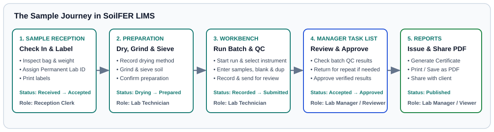

# Wall Poster: The Sample Journey

> *Print this A4 poster and pin it on the main laboratory noticeboard.*

---

## Five Stages from Field Bag to Official Report

| Stage | Who Does It | Screen in SoilFER LIMS | What Happens & Status Badge |
| :--- | :--- | :--- | :--- |
| *1. Sample Reception & Labels* | **Sample Reception Officer** | **Sample Reception** / **Walk-in Intake** | Inspect physical soil bags, click **Accept Sample**, and click **Print labels** (**Standard (101 × 54 mm)** or **Compact (50 × 25 mm)**). Status moves from **Expected** or **Received** to **Accepted**. |
| *2. Drying & Preparation* | **Laboratory Technician** | **My Work** / **Workbench** | Record air or oven drying (**Confirm work is done**), 2 mm sieving (with stone mass), grinding, and sub-sample containers. Status moves from **Accepted** to **Processing**. |
| *3. Bench Run & Batch QC* | **Laboratory Technician** | **Workbench** | Select a **Ready / Calibrated** instrument, enter or paste sample readings alongside **Blank**, **Duplicate**, and **Control** (**LRM** (laboratory reference material — your lab's own in-house check soil) / **CRM** (certified reference material — official standard soil with a certified value)) slots, and submit. Status moves to **Submitted**. |
| *4. Manager Review & Approval* | **Laboratory Manager** / **Quality & Audit Officer** | **Manager Task List** / **QA Dashboard** | Check batch QC and plausibility checks, pick the **Final report value** (**Use this try on report** or **Report mean**), and click **Approve** (or return as **Returned** for a repeat try). Sample status becomes **Approved**. |
| *5. Official Report & Archive* | **Laboratory Manager** | **Reports** (**Result Reports**) | Issue the **Certificate of Analysis** PDF with QR verification code. Store the soil bag as **Archived** until its retention period (**Sample retention after report**) ends, then log **Disposed**. |
