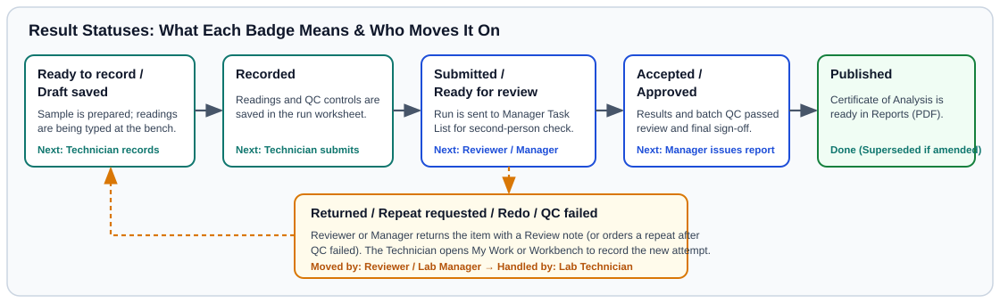

# Bench Card: Status Colours & Badges

> *Pin this A4 card next to any shared workstation. It shows what every status badge means at a glance.*

---

## 1. Sample & Test Status Badges

| On-Screen Badge | Colour | What It Means | Who Acts Next |
| :--- | :--- | :--- | :--- |
| **Expected** | Grey / Blue | Registered from a manifest or KoboToolbox; physical bag has not arrived yet. | **Sample Reception Officer** |
| **Received** / **Accepted** | Blue / Teal | Bag inspected and accepted at reception; barcode label ready. | **Laboratory Technician** (drying & prep) |
| **Drying** / **Prepared** / **Processing** | Amber / Blue | In drying, sieving, or active bench testing. | **Laboratory Technician** |
| **Pending** / **In Progress** | Grey / Blue | Test is in the technician's queue (**My Work** / **Workbench**). | **Laboratory Technician** |
| **Submitted** / **Review Pending** | Purple / Indigo | Bench run is submitted and waiting for review in **Manager Task List**. | **Laboratory Manager** |
| **Returned** / **Redo** | Amber / Orange | Reviewer returned the test for a repeat run or check. | **Laboratory Technician** |
| **On Hold** / **Blocked** | Amber / Red | Paused due to a paperwork hold, unfinished prep gate, or failed QC. | **Laboratory Manager** / **Laboratory Technician** |
| **Approved** | Green | Reviewed and approved; ready for **Certificate of Analysis** PDF in **Reports**. | **Laboratory Manager** |
| **Rejected (Non-Conformance)** | Red | Rejected at intake (for example, damaged or leaking bag). | **Laboratory Manager** |
| **Archived** / **Disposed** | Slate / Grey | Stored in archive after reporting, or safely discarded after retention expired. | Complete |

---

## 2. Equipment & Reference Material Badges

| On-Screen Badge | Colour | What It Means |
| :--- | :--- | :--- |
| **In Service** & **Ready / Calibrated** | Green | Instrument is working and within its calibration due date; ready for bench runs. |
| **Calibration Expiring Soon** | Amber | Instrument can still be used today, but schedule a **Calibration** soon. |
| **Calibration Overdue / Blocked** | Red | Calibration due date has passed; log a fresh **Calibration** or **Verification** in **Equipment** before use. |
| **Active** *(Reference lot)* | Green | **Certified reference material (CRM)** or **Laboratory reference material (LRM)** lot is eligible for batch QC. |
| **Expiring soon** / **Quarantined** / **Expired** | Amber / Red | Reference lot or reagent needs replacement or cannot be placed in a new batch. |
