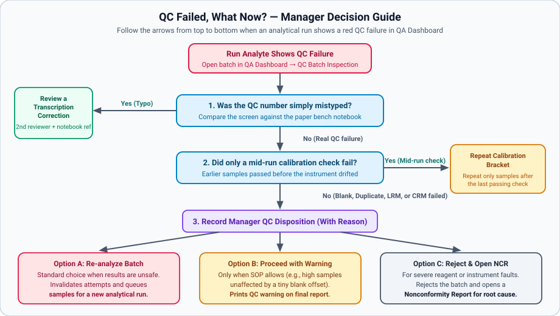

# What to Do When a QC Run Fails (Batch Disposition & Bracket Repeats)

## What This Is For

Inspect a failed analytical run in **QC Batch Inspection**. Check whether the failure was a typing mistake or a mid-run calibration drift, and record your official manager decision (**Re-analyze Batch**, **Repeat calibration bracket** (re-test only the samples measured between the last good instrument check and the failed check), or **Proceed with Warning**).

> *Screenshot placeholder — docs/book/src/img/screenshots/qc-batch-inspection-disposition.png (screenshot coming once the training data is ready): The **QC Batch Inspection** modal showing **Stored QC evaluation — read only**, **Affected Work Items**, and **Record Manager QC Disposition** with **Repeat calibration bracket**, **Proceed with Warning**, **Re-analyze Batch**, and **Confirm Manager Disposition**.*

---

## Before You Start

- Sign in with a **Laboratory Manager** account on the **Sign in to SoilFER LIMS** screen.
- Have the technician's bench worksheet or instrument printout handy. You will need it if you want to check whether a quality control number was mistyped.

---

## Steps

### Step 1: Open the Failed Batch in **QC Batch Inspection**

1. Click **QA Dashboard** in the left menu and open the **QC Batches** tab (or click **Manager Task List** and open the **QC Exceptions** tab).
   *You should see any failed runs highlighted under **QC Exceptions** (**Batches require disposition**).*
2. Click **Inspect** on the failed batch row.
   *You should see the **QC Batch Inspection** window open. It displays **QC FAILED — Quality Gate Active**, **Stored QC evaluation — read only**, and the list of **Affected Work Items**.*

### Step 2: Check If the QC Number Was Simply Mistyped (**Review a transcription correction**)

1. Compare the failed **Measured** reading in **Stored QC evaluation — read only** against the physical bench sheet or instrument file.
2. If the reading on screen was purely a typing mistake (and your laboratory policy enables **Allow reviewed transcription correction of undispositioned failed QC**):
   - In the **Review a transcription correction** panel, select the **Analysis** and **Original reading**.
   - Type the **Corrected reading**, the **Reason**, and the **Recorded source reference** (for example, the bench logbook page or instrument filename).
   - Click **Approve correction and re-evaluate**.
   *Note: The reviewer submitting this correction must be a different person from the run analyst and original author.*

### Step 3: Record Your Manager QC Disposition (**Record Manager QC Disposition**)

If the quality control failure is real (not a typing mistake), scroll down to **Record Manager QC Disposition** (save the manager's decision on a failed batch) and choose one **Manager Decision**:

1. **Repeat calibration bracket** (shown when a mid-run calibration check failed):
   - Select **Repeat calibration bracket** (**Repeat only the work covered by the failed continuing calibration checks.**).
   - Check the count of **Affected work items** measured after the last passing calibration check.
2. **Re-analyze Batch** (standard choice when a blank, duplicate, or reference soil failed):
   - Select **Re-analyze Batch** to reject the batch results for that analyte. This flags all affected sample items for repeat analysis in a new run.
3. **Proceed with Warning** (only when your laboratory SOP allows conditional acceptance):
   - Select **Proceed with Warning** when the samples are scientifically unaffected. For example, a tiny blank reading does not affect a batch where every soil sample has a very high concentration.
4. In **Documented Technical Justification**, type your full scientific explanation or investigation summary.
5. Click **Confirm Manager Disposition** (confirm the manager's batch decision).
   *You should see the banner update to **Manager QC Disposition (Recorded — Read Only)**.*

---

## What Happens Next

- If you chose **Re-analyze Batch** or **Repeat calibration bracket**, the affected sample tasks return to the technician's **Workbench** as **Repeat requested**. They can then be placed into a **new** analytical run.
- If you chose **Proceed with Warning**, sample review is unblocked on the sample's **Review** tab. The reviewer enters a **QC acknowledgement reason (required)** and the final report discloses the warning under **QC deviations:**.

---

## If Something Goes Wrong

- *If you see* **Sealed results require amendments:** *after recording a batch decision →* One or more samples in the batch were already approved or reported. Open **Sample amendments** on those samples to reopen them for retesting (see [Correct an Approved Sample or Issue an Amended Report](../review/amend-a-released-report.md)).
- *If the* **Approve correction and re-evaluate** *button is refused (**Correction refused**) →* Check that you are not the same user who ran the batch or entered the original QC observation. Also verify that the batch has not already been dispositioned.

---

## For the QA Person

- Recorded batch decisions (**Record Manager QC Disposition**) cannot be changed and are permanently stored in **Batch Lifecycle History** and **System Audit Logs**.
- When **Review a transcription correction** is used, SoilFER LIMS never overwrites the failed observation. Both **Original failed evaluation** and **Replacement evaluation** remain visible under **Reviewed QC transcription correction**.
