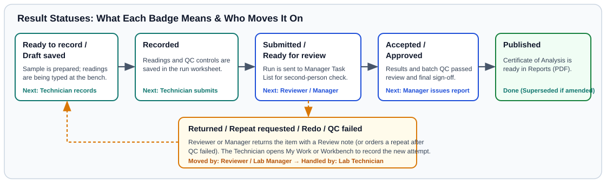

# Statuses A to Z

> *Time:* 5 minutes to look up any badge.
> *Who can do this:* All laboratory staff, reviewers, and clients reading screens or reports.

Look up any sample, preparation, bench, quality control, equipment, or stock status badge you see on screen to find out what it means in plain words and who takes the next step.

---

## 1. Sample Reception, Preparation & Progress Statuses

| Status Shown on Screen | What It Means | Who Acts Next |
| :--- | :--- | :--- |
| **Expected** | The sample was pre-registered from a field survey form or shipping list, and the physical bag has not arrived at the laboratory yet (**Awaiting arrival** / **Not received yet**). | **Sample Reception Officer** inspects the physical bag when the box arrives in **Sample Reception**. |
| **Collected** | Field collection details have been recorded and the sample is on its way to the laboratory. | **Sample Reception Officer** checks in the physical container on arrival. |
| **Draft** | A sample check-in form was started and saved (**Draft saved**) before final confirmation. | **Sample Reception Officer** finishes the remaining checks and clicks **Accept Sample**. |
| **Received** | The physical soil bag has arrived at the reception desk. | **Sample Reception Officer** finishes the condition check and accepts or rejects the sample. |
| **Accepted** | The sample passed physical inspection at reception, received its laboratory code, and is accepted for testing. | **Laboratory Technician** begins drying and preparation. |
| **Lab ID Assigned** | A unique laboratory sample code has been issued to the sample. | **Sample Reception Officer** clicks **Print labels** and hands the sample to preparation. |
| **Rejected (problem recorded)** | The sample arrived damaged, leaking, or too small and was refused, with a problem record saved. | **Laboratory Manager** informs the project coordinator or client and records disposal when ready. |
| **On Hold** | Work on the sample is paused while the laboratory resolves a paperwork question, Kobo field update, or manager hold. | **Laboratory Manager** reviews the hold reason and releases or cancels the item. |
| **Waiting for drying** | The sample is accepted and waiting for air-drying or oven-drying. | **Laboratory Technician** places the sample in the drying area and records drying. |
| **Drying** | The soil sample is currently drying before grinding and sieving. | **Laboratory Technician** clicks **Confirm work is done** when dry. |
| **Waiting for preparation** | Drying is complete and the sample is waiting to be ground and sieved. | **Laboratory Technician** grinds, sieves, and records preparation. |
| **Processing** | Preparation or bench testing is actively underway. | **Laboratory Technician** completes preparation or bench runs in **Workbench**. |
| **Prepared** | Drying and sieving are complete and the sample is ready for analytical bench runs. | **Laboratory Technician** includes the sample in a run in **Workbench**. |
| **Wet Chem In Progress** / **Wet Chem Completed** | Wet-chemistry measurements are underway or finished on the sample. | **Laboratory Technician** submits the batch or **Laboratory Manager** reviews it. |
| **Spectral In Progress** / **Spectral Completed** | Infrared spectroscopy (**MIR** or **NIR**) scanning is underway or finished. | **Laboratory Technician** uploads spectra or **Laboratory Manager** reviews curves in **Spectral Library**. |
| **QA/QC In Progress** / **Analysis Completed** | Analytical measurements are finished and quality control review is underway. | **Laboratory Manager** or **Quality & Audit Officer** reviews in **Manager Task List**. |
| **Partial** | Some (but not all) assigned tests on the sample have been sent for review. | **Laboratory Technician** finishes the remaining tests while **Laboratory Manager** reviews the submitted ones. |
| **Archiving** / **Archived** | Testing and reporting are complete and the sample jar is being moved to or stored in archive storage. | **Laboratory Technician** or **Sample Reception Officer** records the storage shelf. |
| **Disposal** / **Disposed** | The storage period (**Sample retention after report**) has ended and the physical soil material is scheduled for or has completed disposal. | **Laboratory Manager** or authorized staff records final disposal. |

---

## 2. Bench, Work Queue & Final Result Statuses

| Status Shown on Screen | What It Means | Who Acts Next |
| :--- | :--- | :--- |
| **Unassigned** | The test has not been assigned to a technician yet. | **Laboratory Manager** assigns the work in **Manager Task List**. |
| **Assigned** / **Pending** / **Pending Result** | The test is assigned and waiting for the technician to start. | **Laboratory Technician** opens the item from **My Work** or **Workbench**. |
| **Ready to record** | All preparation steps are complete and readings can now be entered. | **Laboratory Technician** enters or pastes readings in **Workbench**. |
| **Open** / **In progress** / **In Progress** | A test task or analytical batch has been started at the bench. | **Laboratory Technician** enters sample and quality control readings. |
| **Draft saved** | Readings are saved as a draft on your screen while you are still working on the run. | **Laboratory Technician** finishes entering readings and records the run. |
| **Recorded** | Readings and bench checks are saved for the run and ready to be sent for review. | **Laboratory Technician** sends the completed run for review. |
| **Submitted** / **Ready for review** | The technician has sent the run to the reviewer or manager for checking. | **Laboratory Manager** inspects the results in **Manager Task List**. |
| **Review Pending** / **Ready for final check** | The result is waiting for reviewer or manager sign-off. | **Laboratory Manager** completes the review check. |
| **Returned** | The reviewer sent the item back with a note asking for a check or repeat run. | **Laboratory Technician** reads the note in **My Work** and records a new measurement try in **Workbench**. |
| **Questioned** | A reading or measurement try has been flagged with a question during review. | **Laboratory Manager** or **Laboratory Technician** checks the raw reading and picks the valid try. |
| **Repeat requested** / **Redo** | A repeat analysis has been ordered for the sample or batch. | **Laboratory Technician** runs the repeat measurement try in **Workbench**. |
| **Blocked** | The step cannot start until an earlier required step (such as drying, instrument calibration, or batch quality checks) is finished. | **Laboratory Technician** or **Laboratory Manager** clears the blocking item shown on screen. |
| **QC failed** | A **Blank**, **Duplicate**, or **Control** fell outside your laboratory's acceptable limit in **Policies**. | **Laboratory Manager** decides the next action in **Manager Task List** or **QA Dashboard**. |
| **Waiting for manager decision** | A batch with a quality control failure is waiting for the manager's recorded decision. | **Laboratory Manager** orders a repeat run, selects **Repeat samples since last good instrument check**, or records the batch decision. |
| **Waived** / **Not reportable** | A test was formally waived or marked **Not reportable** by the manager with a recorded **Reason**. | **Laboratory Manager** continues with the remaining approved results. |
| **Invalidated** | An earlier measurement try was marked invalid and will not be used on the report. | **Laboratory Technician** records a fresh measurement try if required. |
| **Cancelled** | The test order or measurement try was cancelled before reporting. | No further bench work is needed for that item. |
| **Completed** / **Approved** | The reviewer or manager has approved the test result and its quality controls. | **Laboratory Manager** issues the **Certificate of Analysis** PDF in **Reports**. |
| **Published** / **Released** | The **Certificate of Analysis** has been issued and is ready for reading and download. | Client, **Project Manager**, or **Laboratory Manager** downloads the PDF in **Reports**. |
| **Replaced by newer version** | An earlier measurement try or report version was replaced by a newer approved version. | Everyone uses the **Current** version in **Reports**. |

---

## 3. Equipment, Reference Soil & Inventory Statuses

| Status Shown on Screen | Where You See It | What It Means |
| :--- | :--- | :--- |
| **In Service** / **Under Maintenance** / **Out of Service** / **Decommissioned** | **Equipment** (**Service Status**) | Whether an instrument is currently working on the bench. Only **In Service** instruments can be selected in **Workbench**. |
| **Ready / Calibrated** / **Calibration Expiring Soon** / **Calibration Overdue / Blocked** / **Not Configured** | **Equipment** (**ISO Readiness**) | Whether the instrument's **Last Calibration** and **Next Due Date** are current. Log a **Calibration** or **Verification** event if overdue. |
| **Active** / **Quarantined** / **Expired** / **Retired** | **Admin Panel** → **Quality** (**Reference materials**) | Whether a **Certified reference material (CRM)** (official standard soil) or **Laboratory reference material (LRM)** (in-house check soil) bottle can be used in new analytical batches. |
| **Certified** / **Indicative** / **Consensus** / **Lab assigned** | **Reference materials** (**Value type**) | How the reference soil's target **Assigned value** was established. |
| **In Stock** / **Low Stock Warning** / **LOW** / **LOW? (UNCERTAIN)** / **OUT OF STOCK** / **COUNT NEEDED** / **Expiring Soon** / **Expired** | **Inventory** (**Reagents & Inventory**) | Current reagent or supply stock and expiry alerts. Click **Adjust Stock** when opening or refilling bottles. |
| **Operational** / **Paused** / **Retired** | **My Laboratory** / **Lab Management** | Facility status. A **Paused** laboratory holds new sample check-ins and result entry while keeping existing records safe. |
