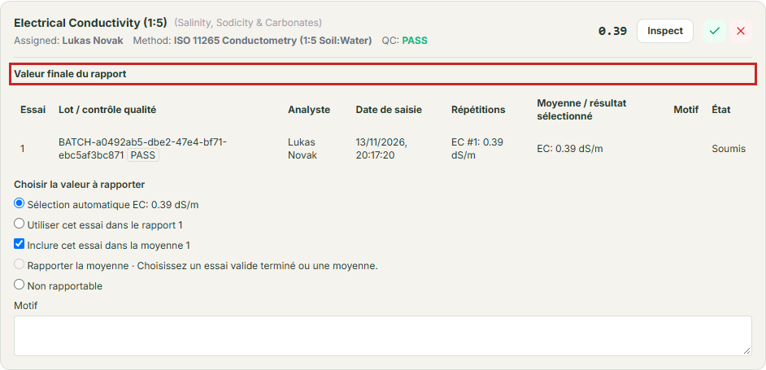
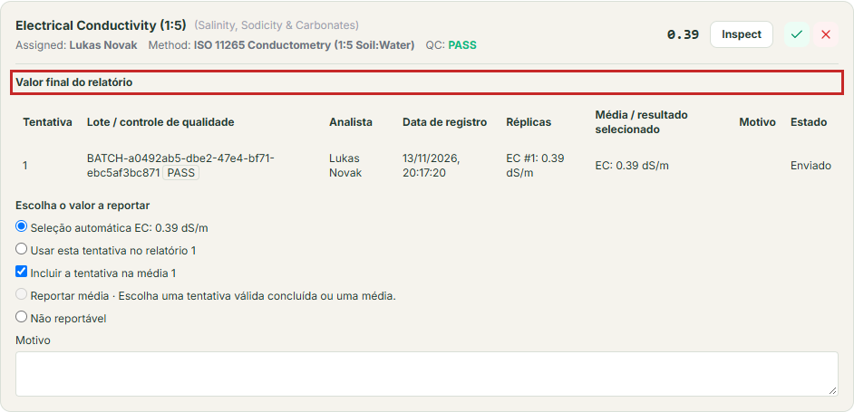

# Review Submitted Results and Choose the Reported Value

## What This Is For

Inspect measurements submitted by technicians, review quality control verdicts and **Cross-parameter plausibility** flags, approve or reject technician **Unusual-value requests**, and choose the official **Final report value** for each test.

## Practice screens in French and Portuguese

This submitted conductivity result shows its recorded batch quality check, analyst, reading and final-value choices. The picture shows the review before any acceptance is recorded. These pictures use fictional **Demo Soil Lab** records on a local practice copy. The red outline points out the control to find; it is a guide annotation, not an application warning. Method names and practice notes keep their seeded wording. Select a picture to open it at full size.

Français

Português

---

## Before You Start

- Sign in with a **Laboratory Manager** account (or an account with review authority).
- Under two-person review rules, you must be a different person from the technician who recorded the try.

---

## Steps

### Part 1: Open a Submitted Sample and Check Plausibility & Overrides

1. Click **Manager Task List** in the left menu, open the **Review Submissions** tab, and click **Review** on a sample card.
   *You should see the sample open on its **Review** tab.*
2. If a technician requested an out-of-range approval, check the **Unusual-value requests** panel first:
   - Read the technician's **Reason**, type your **Decision reason**, and click **Approve** or **Reject**.
3. Scroll to the **Cross-parameter plausibility** card and check the **Outcome** column (**Pass**, **Flagged**, or **Not evaluated**) for **Texture closure**, **Exchangeable bases / CEC**, **Base saturation**, **C:N ratio**, and pH comparisons.

### Part 2: Choose and Save the Official **Final report value**

1. On each submitted test row, look at the **Final report value** table showing every recorded **Try**, **Batch / QC** status, **Analyst**, **Recorded date**, **Replicates**, and **Mean / selected output**.
2. Under **Choose the value to report**, pick how this test should be reported:
   - **Automatic selection**: uses your laboratory's default reporting rule when only one clean try exists.
   - **Use this try on report**: picks one specific try (for example, choosing *Try 2* after *Try 1* was diluted or invalidated).
   - **Report mean**: averages two or more selected tries (**Include try in average**) that agree within the method's repeatability limit.
   - **Not reportable**: waives the test when a valid number cannot be produced (for example, insufficient sample left).
3. If you chose **Not reportable** or selected a previously **Questioned** try, type the required explanation in **Reason**.
4. Click **Save final report value**.
   *You should see **Current selection** update to show the saved value and unit.*
5. For soil particle size, save the **Final report value** for **Sand**, **Silt**, and **Clay** first, and then save the **Texture (Sand/Silt/Clay)** selection.

---

## What Happens Next

Once a valid **Final report value** is saved for a test, you can click **Accept Item** (or **Return for correction** if a repeat is needed; see [Return a Test for Repeat or Give Final Sample Approval](return-for-repeat-or-approve.md)).

---

## If Something Goes Wrong

- *If you see* **The selected measurements exceed their recorded repeatability limit.** *when clicking* **Save final report value** *→* The tries you ticked for **Report mean** are too far apart. Choose a single valid try (**Use this try on report**) or return the test for a repeat check.
- *If you see* **Censored values cannot be averaged.** *→* One of the tries is a **< LOQ** (below the limit of quantification — the lowest amount the method can measure reliably) reading (**Report below quantification limit**). Choose **Use this try on report** instead of **Report mean**.
- *If you see* **Accept and select SAND, SILT and CLAY before TEXTURE.** *→* Save the three individual particle-size fraction selections first, then save **Texture (Sand/Silt/Clay)**.

---

## For the QA Person

- SoilFER LIMS stores the reviewer's explicit **Final report value** selection as a permanent, locked record linked to the specific measurement try IDs and repeatability limits in effect at review time.
- When **Report mean** is saved, the server stores the full-precision arithmetic mean and rounds it to the method's configured decimal places only when rendering the Certificate of Analysis.
