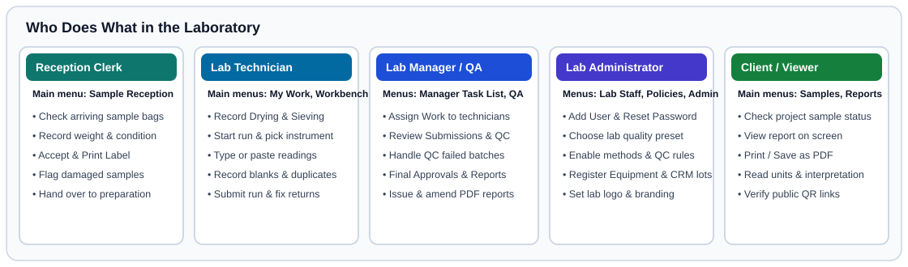

# Your First Day as a Laboratory Manager

## What This Is For

Walk through a complete day managing laboratory work and quality control. You will assign incoming tests to technicians, review a passing analytical batch, handle a batch where quality control failed, and issue a signed PDF Certificate of Analysis.

---

## Before You Start

- Sign in with a **Laboratory Manager** account on the **Sign in to SoilFER LIMS** screen.
- Make sure your practice samples have been received and at least two practice batches have been submitted from **Workbench**.

---

## Steps

### Morning: Check the Manager Task List and Assign Work

1. Click **Manager Task List** in the left menu.
   *You should see summary cards for **New Sample** (**Review Intake**), **Analysis Pending** (**Assign Tech**), **Results Pending** (**Review**), and **Final Approval** (**Approve**), plus tabs below.*
2. Click the **Assign Work** tab.
3. Select the newly prepared samples and assign the soil tests to the technicians on duty today.
   *You should see those tasks move from **Unassigned** to **Assigned** in each technician's **My Work** list.*

### Midday: Review a Passing Batch

1. In **Manager Task List**, click the **Review Submissions** tab.
   *You should see runs sent by technicians with status **Submitted** / **Ready for review**.*
2. Open the first submitted batch and inspect the sample readings alongside the *blank*, *duplicate*, and *reference soil* results (see [Glossary](../reference/glossary.md)).
3. Confirm that **All final report values passed their quality checks.** is shown and that the technician who recorded the run is not the same person reviewing it (when your laboratory's policy requires two-person review).
4. Click **Review** / **Approve** to accept the submitted batch.
   *You should see the results advance to **Accepted** and **Approved**.*

### Afternoon: Handle a Batch Where Quality Control Failed

1. In **Manager Task List**, click the **QC Exceptions** tab (or open **QA Dashboard** in the left menu).
   *You should see any batch marked **QC failed** or **Waiting for manager decision**.*
2. Open the failed batch worksheet to see which control failed (for example, a duplicate pair that disagreed beyond your laboratory's limit, or a reference soil outside its target recovery range).
3. Choose the appropriate manager decision for your laboratory:
   - *Order a full or partial repeat:* To send a sample or batch back for re-testing, click **Return for repeat testing**, select a **Repeat reason** (such as **QC batch failure**, **Duplicate disagreement**, or **Instrument fault**), write clear instructions in **Review note**, and click **Confirm return**. If only a group of samples between two instrument check standards failed, choose **Repeat samples since last good instrument check**.
   - *Accept with a documented reason (when permitted by your laboratory's policy):* Enter the required explanation in **QC acknowledgement reason (required)** so your name and reason appear on the report record.
   *Your laboratory decides whether quality control failures block approval or allow a documented manager note (see [Per-Lab Settings, Presets & Method Overrides](../usage/lab-settings-and-presets.md)).*

### Late Afternoon: Issue and Share a Certificate of Analysis

1. Click **Reports** in the left menu. You should see the **Result Reports** screen.
2. Find the sample or project with **Approved** results and click **View report**.
3. Check the laboratory header, sample identifiers, approved values, units, and quality control summary.
4. Click **Print / Save as PDF** to download the official PDF Certificate of Analysis, or click **Share report** (**Create Public Link**) to generate a time-limited link for the client.

---

## What Happens Next

Once a report is issued, its status is **Published** and clients or project coordinators can view or download it in **Reports**. For detailed decision guides, see [Quality Control, Control Charts & Failed QC](../usage/qc-management.md), [Lab Manager & QA: Review, Approval & Plausibility Checks](../usage/review-and-approval.md), and [Lab Manager & QA: Certificates of Analysis, PDF Reports & Amendments](../usage/reporting-pdf.md).

---

## If Something Goes Wrong

- *If you see* **The batch failed quality checks. The lab manager must record a decision.** *→* You cannot approve the results until you either order a repeat run or record a manager batch decision on the failed batch in **Manager Task List** or **QA Dashboard**.
- *If an error is discovered on a report that was already published →* Never edit the database directly. Open the sample or report amendment workflow to issue a new revision; the old report is automatically marked **Replaced by newer version** and public QR links stop serving the replaced PDF.
- *If repeated tries on the same item reach your laboratory's repeat limit →* If you see **This laboratory’s configured attempt limit has been reached.** (this test has reached the maximum number of repeat tries allowed by your lab), open **QA Dashboard** to record a problem review before ordering another try.

---

## For the QA Person

- Separation of duties is enforced according to your laboratory's policy in **Policies**: under strict ISO/IEC 17025 settings, the user who recorded a measurement try cannot approve that same try.
- Every manager batch decision, repeat order, and report amendment records the actor, timestamp, and written reason in the permanent audit log.
