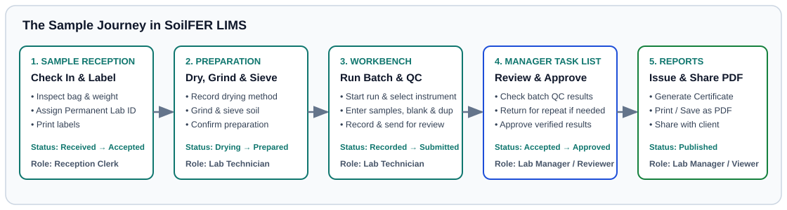

# Your First Day at Sample Reception

## What This Is For

Walk through a complete day at the reception desk using five practice soil bags from the Demo Soil Lab. You will check in pre-registered field samples, handle one damaged bag, register a walk-in sample, print barcode labels, and hand the accepted samples over for drying.

---

## Before You Start

- Sign in with a **Sample Reception** or **Laboratory Manager** account on the **Sign in to SoilFER LIMS** screen.
- Have your practice sample box, bench scale, and barcode label printer ready.
- Check the top right **User Menu** to confirm you are signed in under your own name and laboratory.

---

## Steps

### Morning: Check In Four Pre-Registered Field Samples

1. Click **Sample Reception** in the left menu.
   *You should see the **Sample Reception & Intake** screen with the **Project Sample** tab selected.*
2. Click **Search manifest by Sample ID...** (or click **Scan** to use a barcode scanner) and look up the first practice field bag, which is currently in **Expected** status.
   *You should see the field collection details and site photo loaded on screen.*
3. Inspect the physical soil bag on your desk: check that the bag is sealed, the label matches the screen, and there is enough soil for the requested tests.
4. Weigh the bag and enter the observed condition and notes in **Intake Notes / Visual Observations**.
5. Click **Accept & Print Label** (or **Complete Intake**).
   *You should see **INTAKE CONFIRMED!**, the sample status change from **Expected** to **Received** and **Accepted**, and its **Permanent Lab ID** assigned.*
6. In the **Print labels** window, choose **Standard (101 × 54 mm)** or **Compact (50 × 25 mm)** under **Format**, set **Copies per label**, and click **Print labels**.
7. Stick the printed barcode label onto the sample container and click **Next Sample** to repeat for the next three good bags in the box.

### Midday: Record One Damaged Sample Bag

1. Look up the fifth practice bag in **Sample Reception**.
2. Notice that the physical bag arrived torn and leaking, so the soil is contaminated.
3. Select **Non-Conformance** / **Reject** and type what you observed in **Describe the observed problem** (for example, that the bag arrived torn and spilled in transit).
   *You should see the sample recorded with status **Rejected (Non-Conformance)** so it never enters the drying room or bench queues.*

### Afternoon: Register a Farmer Walk-In Sample and Hand Over to the Lab

1. Click **Walk-in / External** in **Sample Reception** when a customer brings a soil bag directly to the counter without a field survey code.
2. Fill in **1. Submitter Details** (**First Name \***, **Last Name \***, **Phone (Required) \***, and **Organization / Farm Name**).
3. Fill in **2. Sample Context** and **Analysis Requirements**, then click **Accept & Print Label**.
   *You should see the new sample receive its **Permanent Lab ID** and move to **Waiting for drying**.*
4. Place all accepted, labelled sample containers on the drying tray and hand them to the preparation technician.

---

## What Happens Next

Every sample you accepted now appears in the technician's queue with status **Waiting for drying**. See [Reception: Receiving Samples & Labels](../usage/reception-and-intake.md) and [Preparation: Drying, Grinding, Storage & Custody](../usage/preparation-and-custody.md) for detailed guides on each reception task.

---

## If Something Goes Wrong

- **If you need to step away before finishing a sample check-in →** Click **Save Draft**. The record is saved in **Draft** status so you can finish it when you return.
- **If a printed barcode label is smudged or torn →** Open the sample, click **Print labels**, enter a short note in **Reason for reprint**, and click **Print labels** again.
- **If the barcode code is too long for a small sticker →** If you see **This code does not fit this label at a readable bar width. Choose the standard format or ask the laboratory manager to review the issued code.**, switch **Format** to **Standard (101 × 54 mm)**.
- **If a field sample does not appear under Expected →** Click **Samples** in the left menu to check whether a colleague already received it, or ask your Laboratory Manager to synchronize the project form in [KoboToolbox Field Integration](../usage/kobotoolbox.md).

---

## For the QA Person

- Scanning a barcode or synchronizing a field survey only locates or imports the record in **Expected** status; physical custody begins only when the reception clerk completes intake and sets the official reception date.
- Every label print and reprint is logged in the audit trail before the browser print window opens, and reprints require a recorded reason in **Reason for reprint**.
- Your laboratory configures which reception checks are mandatory or optional for project samples and walk-in customers under **Policies** (see [Per-Lab Settings, Presets & Method Overrides](../usage/lab-settings-and-presets.md)).
