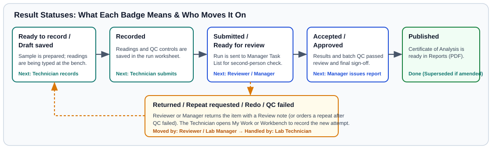

# Your First Day as a Laboratory Technician

## What This Is For

Walk through a complete technician shift using five practice soil samples. You will record drying and sieving, start an analytical batch at the bench, enter sample readings along with a blank, a duplicate, and a reference soil, send the completed run for review, and fix one returned item.

See the [French and Portuguese bench examples](../bench/find-my-work.md#practice-screens-in-french-and-portuguese) from Demo Soil Lab before opening your practice run.

---

## Before You Start

- Sign in with a **Laboratory Technician** account on the **Sign in to SoilFER LIMS** screen.
- If your laboratory uses bench PIN confirmation, set your personal **4 to 8 digit PIN** in the **Workbench PIN dialog** when it first appears for recording results or unlocking the bench. Confirm it with your account password. If your PIN is already set, enter it when prompted.
- Make sure the five practice samples have been accepted at reception and are on your preparation bench.

---

## Steps

### Step 1: Check Your Assigned Queue

1. Click **My Work** in the left menu.
   *You should see **My Assigned Tasks** listing the samples waiting for preparation and analysis in your laboratory.*

### Step 2: Record Drying, Grinding, and Sieving

1. Open **Workbench** in the left menu and select the preparation step (**Drying**, **Grinding**, or **Sieving**) for your five practice samples.
2. Choose the **Method** (such as **Air dried** or **Oven 40 °C**), select the **Equipment**, and enter **Temperature (°C)**, **Mass before (g)**, **Mass after (g)**, and **Sieve (mm)**.
3. Confirm completion for the prepared samples.
   *You should see the sample status advance from **Drying** and **Processing** to **Prepared**, and the analytical tests become **Ready to record**.*

### Step 3: Start an Analytical Run and Record Quality Controls

1. In **Workbench**, select your analytical method (for example, soil pH in water) and open the **QC run** worksheet (**Open run worksheet**).
   *Your laboratory decides the batch size and control positions (many laboratories use up to 20 samples per batch; see [Per-Lab Settings, Presets & Method Overrides](../usage/lab-settings-and-presets.md)).*
2. Click **Select instrument** to pick the calibrated meter or instrument you are using today, verify the **Linked check soil bottle**, and click **Start run**.
   *You should see the run open with rows for your soil samples plus the required quality control positions:*
   - A *blank* (a reagent-only check with no soil, used to check for contamination; see [Glossary](../reference/glossary.md)).
   - A *duplicate* (a second weighing of one sample in the batch, used to check precision; see [Glossary](../reference/glossary.md)).
   - A *reference soil* (a laboratory reference material or certified reference material with a known target value, used to check accuracy; see [Glossary](../reference/glossary.md)).

### Step 4: Enter or Paste Readings and Send for Review

1. Type each measurement into its row and click **Record this sample** (or paste rows from your instrument spreadsheet and check the paste preview).
   *While you are still working, unfinished rows show **Draft saved**. Once a row is confirmed, its status shows **Recorded**.*
2. Enter the measured values for the blank, duplicate, and reference soil rows, click **Save observations**, and click **Evaluate QC**.
3. When every sample and control row in the run is **Recorded**, click **Submit** to send the batch to your reviewer.
   *You should see the status change to **Submitted** / **Ready for review**.*

### Step 5: Handle a Returned Item

1. If the reviewer spots a question on one sample, that item reappears in **My Work** with status **Returned** or **Repeat requested**.
2. Open the item, read the reviewer's **Review note**, re-measure or check the sample on a fresh try, and click **Submit** again.
   *Your earlier try stays safely in the history, and the new try goes back to the reviewer.*

---

## What Happens Next

Your **Submitted** batch appears in your manager's **Manager Task List** under **Review Submissions**. See [Preparation: Drying, Grinding, Storage & Custody](../usage/preparation-and-custody.md) and [Technician: Workbench & Analytical Runs](../usage/technician-workbench.md) for full details on every bench task.

---

## If Something Goes Wrong

- *If you cannot type a result for a sample →* Check whether the sample status is still **Waiting for drying** or **Waiting for preparation**. Preparation must be confirmed before bench readings can be recorded.
- *If you see* **Calibration verification requires a registered instrument. Ask a manager to select one before starting.** *→* Select an active, calibrated instrument in **Select instrument**, or ask your Laboratory Manager to update its calibration in **Equipment**.
- *If you see* **Recording was not confirmed for this row.** *→* Click **Record this sample** (or **Retry failed** if the network flickered) before closing the screen so your reading moves from **Draft saved** to **Recorded**.

---

## For the QA Person

- Starting a run (**Start run**) freezes the batch membership and quality control criteria version for that run so later policy edits never alter an in-progress or historical evaluation.
- Returned items (**Returned** / **Repeat requested**) create a new numbered try rather than overwriting the original reading, preserving the full log of who handled the sample and where.
