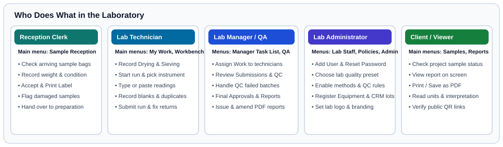

# Which Part Is for Me?

## What This Is For

You do not need to read this whole manual. Use the table below to find the chapters written for your job in the laboratory.

---

## Find Your Role

| Who You Are | What You Do in SoilFER LIMS | Where to Go in This Manual |
| :--- | :--- | :--- |
| **Reception Clerk** | Receive arriving sample boxes, check bag condition, record sample weight and moisture, and print labels. | 1. [Your First Day at Sample Reception](./first-day-reception.md) 2. [Finding Your Way Around the Screen](./screen-tour.md) 3. [Sample Reception & Intake](../usage/reception-and-intake.md) 4. [KoboToolbox Field Integration](../usage/kobotoolbox.md) |
| **Laboratory Technician** | Dry, grind, and sieve soil samples, run analytical batches at the bench, type or paste readings, and record blanks, duplicates, and reference soils. | 1. [Your First Day as a Laboratory Technician](./first-day-technician.md) 2. [Drying, Preparation, Storage & Custody](../usage/preparation-and-custody.md) 3. [Technician Workbench & Analytical Runs](../usage/technician-workbench.md) 4. [Shared Bench Terminals, Attempts & Repeats](../usage/bench-terminals-and-attempts.md) 5. [Spectral Data Management (MIR & Vis-NIR)](../usage/spectral.md) |
| **Laboratory Manager or QA Officer** | Assign work, review results sent from the bench, handle quality control warnings or failures, approve batches, and issue Certificates of Analysis. | 1. [Your First Day as a Laboratory Manager](./first-day-manager.md) 2. [Quality Control, Control Charts & Failed QC](../usage/qc-management.md) 3. [Review, Approval & Plausibility Checks](../usage/review-and-approval.md) 4. [Certificates of Analysis, PDF Reports & Amendments](../usage/reporting-pdf.md) |
| **Laboratory Administrator** *(often the Lab Manager)* | Set up the laboratory profile, create staff accounts, switch on analytical methods, choose quality rules, and prepare for pilot launch. | 1. [Your First Day as a Laboratory Administrator](./first-day-admin.md) 2. [Lab Go-Live Checklist](../admin/go-live-checklist.md) 3. [Roles, Permissions & Separation of Duties](../usage/roles.md) 4. [Per-Lab Settings, Presets & Method Overrides](../usage/lab-settings-and-presets.md) 5. [Pilot Launch Kit](../launch/index.md) |
| **Client, Project Coordinator, or Viewer** | Check project progress, read approved soil test results, and download signed PDF reports. | 1. [First Login & Lab Setup](../usage/first-login.md) 2. [Reading Results & Reports](../usage/viewer-guide.md) 3. [Controlled Units & Agronomic Interpretation](../usage/agronomic-interpretation.md) |
| **IT Specialist** | Install the server, configure HTTPS, run daily backups, and apply software updates. | Go to the **For IT** section at the back of this manual: [What You Will Need](../getting-started/prerequisites.md), [Configuration](../installation/configuration.md), [Backing Up Your Data](../maintenance/backups.md), and [Updating SoilFER-LIMS](../maintenance/updates.md). |

---

## Order of the First Day

1. The administrator or manager [sets up the laboratory](./first-day-admin.md).
2. Reception [receives and accepts the practice samples](./first-day-reception.md).
3. The manager [assigns the work in the morning](./first-day-manager.md#morning-check-the-manager-task-list-and-assign-work).
4. The technician [prepares the samples, records results, and submits batches](./first-day-technician.md).
5. The manager [reviews submitted work from midday onwards](./first-day-manager.md#midday-review-a-passing-batch), handles QC exceptions, and issues the certificate. When two-person review is on, this reviewer must be a different person from the analyst.

---

## How Every Task Page Works

Every daily work page in this manual follows the same order so you can scan it quickly at the bench:

1. **What this is for** tells you the goal in one or two sentences.
2. **Before you start** lists what you need ready.
3. **Steps** gives you one action per numbered step, with exact button names in **bold**.
4. **What happens next** tells you who picks up the work after you finish.
5. **If something goes wrong** shows how to fix common problems on the spot.
6. **For the QA person** at the bottom of the page holds detailed quality rules and formulas for managers and auditors.

---

## What Happens Next

Continue to [First Login & Lab Setup](../usage/first-login.md) to sign in and set your personal password, or open [Finding Your Way Around the Screen](./screen-tour.md) to learn where the main menus and buttons are.
