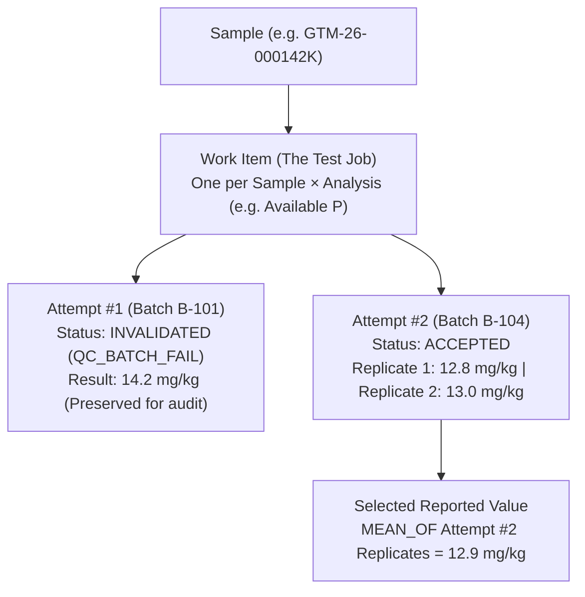

# Shared Bench Terminals, Work Items, Attempts & Repeats

In many soil laboratories, two or three technicians share a single computer or tablet next to the pH meter, balance, or spectrometer. At the same time, real laboratory work involves repeats, dilutions, instrument hiccups, and occasional typing mistakes. This guide explains how SoilFER-LIMS keeps shared bench computers safe and how **Work Items**, **Work Attempts**, **Repeats**, and **Corrections** work together.

---

## Part 1: Shared Bench Terminals

When a computer sits on a shared laboratory bench, you need to make sure:
1. Nobody accidentally types measurements under another technician's name while they step away to rinse glassware.
2. Nobody loses half a page of typed readings if their login session times out.
3. Switching from Technician A to Technician B cleanly saves Technician A's drafts and clears them from the local device before Technician B signs in.

### Setting Up Your Personal Bench PIN
Each technician sets a personal **Bench PIN** (protected with bcrypt encryption, separate from your main password):
1. Open your profile/bench settings in the top bar (or when prompted after Bench Mode is enabled).
2. Enter your current account password and choose your **Bench PIN**.
3. Save. *(For security, 5 incorrect PIN attempts temporarily lock PIN entry for 5 minutes.)*

### How Bench Mode Works Day-to-Day

| Feature | Policy Setting & Shipped Defaults | What You See / What You Do / What Happens Next |
| :--- | :--- | :--- |
| **Idle Screen Lock** | `bench.idleLockMinutes` • Strict: `5 min` • Basic: `15 min` • Advisory: `Off` | **What you see**: After no keyboard or mouse activity for the configured minutes, a lock overlay covers the Workbench. **What you do**: Enter your **Bench PIN** to unlock. **What happens next**: While locked, no keystrokes or barcode scans can reach the worksheet grid. Once unlocked, you return to the exact cell you were editing with all typed drafts intact. |
| **PIN Confirmation at Record** | `bench.pinAtRecord` • Strict: `On` • Basic / Advisory: `Configurable` | **What you see**: When you click **Record all ready** and confirm the preview, a PIN prompt appears. **What you do**: Type your personal **Bench PIN**. **What happens next**: The server verifies your PIN and records the results under your authenticated identity. |
| **Fast Analyst Switch** | Always available on Bench Terminals | **What you see**: The **Switch Analyst** button in the top bench bar. **What you do**: Click **Switch Analyst** when handing the terminal to a colleague. **What happens next**: SoilFER-LIMS flushes and syncs all your pending drafts to the server first. If any draft cannot be sent (for example, the network cable is unplugged), it warns you and keeps your session open so nothing is lost. Once synced, it clears only your local drafts/outbox from the browser and opens the sign-in screen for the next analyst. |
| **Session Expiry Protection & Handed-Over Drafts** | Automatic | • **In-place Re-Login**: If your login token expires during a long run, an in-place re-login dialog opens for the **same analyst** and automatically resends your typed values—never redirecting away or wiping your screen. • **Instrument Change Safety**: Changing the selected instrument on a draft merges cleanly without erasing your typed number. • **Reassigned Work Items**: If a manager reassigns an in-progress work item from Technician A to Technician B, Technician B sees the saved server draft clearly labeled with who originally saved it. |

---

## Part 2: Understanding Work Items vs. Work Attempts

To keep a clean, auditable history of every measurement without ever overwriting old data, SoilFER-LIMS separates **what was ordered** from **each time it was measured**:

- **Work Item (`WorkItem`)**: Represents **the test job** for one sample and one analysis (for example, *Available Phosphorus on Sample `GTM-26-000142K`*). There is only one canonical Work Item per sample × analysis.
- **Work Attempt (`WorkAttempt`)**: Represents **one execution of that test in one analytical batch**.
  - The first time you measure the sample, it is **Attempt #1 (`attemptNo = 1`)**.
  - An attempt holds 1 or more replicate measurements (`Result` rows with `replicateNo = 1, 2, ...`), the raw calculation inputs, the optional linked physical **Aliquot (`ALIQUOT`)**, the frozen instrument readiness snapshot, and the link to the **Analytical Batch**.
  - **Old attempts are never overwritten or deleted**: If a test must be repeated, SoilFER-LIMS creates a brand-new attempt (`attemptNo + 1`) and updates the old attempt's status (to `INVALIDATED` or `QUESTIONED`).
- **Reported Value (`ReportedValueSelection`)**: The official result printed on the Certificate of Analysis and sent to exports. It is chosen explicitly during review—**never** by a hidden "latest row wins" rule.

---

## Part 3: Repeats vs. Transcription Corrections

When something goes wrong with a measurement, what you do depends on **what happened** and **whether the work item has already been submitted**.

### Quick Decision Table: Repeat Reason Codes

| Reason Code | Plain-Language Meaning | Who Can Trigger It | What Happens to Original Attempt | Default Reported Value |
| :--- | :--- | :--- | :--- | :--- |
| `TRANSCRIPTION_ERROR` | You typed the wrong number from your paper notebook or balance display (no new lab measurement needed). | **Technician** (before submit) or **Reviewer** | Corrected in-place on the **same attempt** (old value kept in audit trail; mandatory reason). | The corrected value |
| `INSTRUMENT_FAULT` | Instrument lamp flickered, autosampler clogged, or drift occurred during the run. | **Technician** (before submit) or **Reviewer / Manager** | Becomes `INVALIDATED` | New attempt (`attemptNo + 1`) |
| `PREP_ERROR` | Spilled extract, wrong pipette volume, or weighing mistake during preparation. | **Technician** (before submit) or **Reviewer** | Becomes `INVALIDATED` | New attempt (`attemptNo + 1`) |
| `ABOVE_RANGE_DILUTION` | Sample concentration is above the highest calibration standard; extract must be diluted and re-read. | **Technician** (before submit) or **System / Reviewer** | Becomes `INVALIDATED` | New attempt (with dilution factor) |
| `QC_BATCH_FAIL` | The batch's Method Blank, CRM, LRM, or bracketing CCV failed QC criteria. | **System** (on batch `REANALYZE` or CCV bracket failure) | Becomes `INVALIDATED` | New attempt in a **different** batch |
| `DUPLICATE_DISAGREEMENT` | The sample's own analytical duplicate pair disagreed beyond the method's RPD / $\|\Delta\|$ limit. | **System** | Becomes `QUESTIONED` | Third measurement / ISO 5725 range rule |
| `REVIEW_OUTLIER` | Result looks implausible or fails a cross-parameter check during manager review. | **Reviewer / Manager** | Becomes `QUESTIONED` | Reviewer selects: `ORIGINAL`, `REPEAT`, or `MEAN` (if $\|\Delta\| \le r$) |
| `CONFIRMATION` | Reviewer requests a second check to confirm an unusual value (e.g. sum of bases > CEC). | **Reviewer / Manager** | Becomes `QUESTIONED` | Reviewer selects |
| `CLIENT_RETEST` | Client or manager requests a retest **after** the sample has already been approved/reported. | **Lab Manager** (requires a formal **Sample Amendment**) | Stays `ACCEPTED` | Reviewer selects; amended report shows revision history |
| `OTHER` | Any other documented laboratory reason (free-text explanation is **mandatory**). | **Technician** (before submit) or **Reviewer** | `INVALIDATED` or `QUESTIONED` | Reviewer selects |

---

### Scenario 1: Fixing a Typing Mistake (`TRANSCRIPTION_ERROR`)
Suppose you wrote `6.45` in your bench notebook, accidentally typed `64.5`, and clicked **Record**:
- **What you see**: On a recorded work item, clicking **Correct / Repeat** offers **Transcription Correction (`TRANSCRIPTION_ERROR`)**.
- **What you do**: Select `TRANSCRIPTION_ERROR`, choose the target replicate (if the method uses multiple replicates), enter the corrected number (`6.45`), and type a **mandatory explanation** (for example, *"Decimal point mistyped from bench logbook page 14"*).
- **What happens next**: SoilFER-LIMS supersedes the mistyped `Result` within the **same Work Attempt** without requiring a new chemical analysis, keeps the old number (`64.5`) permanently visible in the audit trail, and requires a fresh manager review if the item had already been submitted.

### Scenario 2: Starting a Repeat Before Submission (Technician)
Suppose an extract tube tipped over or exceeded the calibration curve before you submitted the run:
- **What you see**: The **Request Repeat** action on your recorded work item.
- **What you do**: Select `PREP_ERROR`, `INSTRUMENT_FAULT`, or `ABOVE_RANGE_DILUTION`, optionally pick a new physical **Aliquot (`ALIQUOT`)** if re-weighing, add a note, and confirm.
- **What happens next**:
  - Attempt #1 is marked `INVALIDATED` and a new **Attempt #2 (`OPEN`)** is reserved.
  - **Crucial Batch Rule**: If a repeat was caused by a failed QC batch (`QC_BATCH_FAIL`), the repeat attempt **must be measured in a different, passing analytical batch**. The server refuses to attach a repeat attempt to a batch whose QC status is `QC_FAIL` or whose disposition is `REANALYZE` / `REJECT`.

### Scenario 3: Partial Repeat Replacement After an Instrument Fault
What if a test has multiple replicates (for example, Replicate 1 and Replicate 2) and the instrument faulted only on Replicate 2 while the work item is still `IN_PROGRESS` or `COMPLETED` (and not frozen in a `REPEAT_REQUIRED` failed batch)?
- **What you see**: A **Lab Manager** can authorize a **Partial Repeat Replacement (`INSTRUMENT_FAULT`)** specifying which replicate(s) failed.
- **What you do**: The technician records the replacement reading for the affected replicate(s) in the new attempt.
- **What happens next**: Each prior replicate result is superseded only as its replacement replicate is recorded, and SoilFER-LIMS refuses submission (`ATTEMPT_REPLICATE_SET_INCOMPLETE`) until the full set of required replicate numbers is complete.

---

## Part 4: Attempt Limits & Nonconformity Reports (NCR)

To prevent endless re-testing without investigating the root cause, each laboratory configures a maximum number of attempts per test before a formal investigation is required:

- **Configurable Policy Key**: `repeats.maxAttemptsBeforeNcr` in **Settings → Laboratory Policy**.
  - **Shipped preset defaults**:
    - `ISO17025_STRICT`: **3 attempts** (a 4th attempt requires manager approval + NCR)
    - `BASIC`: **5 attempts**
    - `ADVISORY`: **No limit**
- **What happens when a test reaches the attempt limit**:
  - **What you see**: If a test already has 3 attempts (under the `Strict` preset) and needs a 4th attempt, the system blocks ordinary repeat creation and prompts for a **Manager NCR Override**.
  - **What you do**: A **Lab Manager** opens a **Nonconformity Report (`NonconformityReport`, ISO/IEC 17025 §7.10)** documenting what went wrong, the root cause, and the corrective action taken, and links that fresh NCR to authorize the extra attempt.
  - **What happens next**: The new attempt is unlocked and permanently linked to the Nonconformity Report, which is tracked on the **QA Dashboard** until closed.
