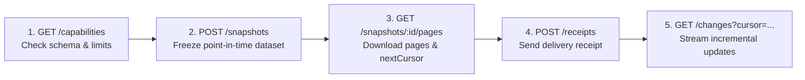

# Data Exchange, NSIS / OpenNSIS & API v2

SoilFER LIMS includes a built-in **Data Exchange Gateway** that allows national soil programmes, GIS portals, and external systems such as **FAO OpenNSIS** and **GLOSIS** to harvest approved soil data securely without disrupting everyday work inside the laboratory.

---

## 1. How Data Exchange Protects the Laboratory

The Data Exchange Gateway is designed around four non-negotiable guarantees for laboratory staff:

1. **Only Approved Data Leaves the Lab**: External systems can only see samples whose status is **`APPROVED`** or **`REPORTED` (`RELEASED`)**. Samples that are still in reception, preparation, bench testing, or waiting for review are never exposed.
2. **Strict Laboratory Scoping (Fail-Closed)**: Every external API key is locked to specific laboratories and countries. If an API key does not explicitly list your laboratory, it receives zero records from your lab.
3. **Zero Disruption to Reception & Bench Work**: External synchronization happens in the background on a read-only publication layer. Even if a national database is offline, laboratory intake, testing, and PDF reporting continue normally.
4. **Truthful Provenance**: Missing GPS coordinates or missing soil depths remain `null` (never replaced with fake `0, 0` coordinates or default `0–20 cm` depths), decimal depths (such as `0.0–15.5 cm`) are preserved without rounding, and field collection dates are kept strictly separate from laboratory reception timestamps.

---

## 2. Reported Values (v1 / CSV / Excel) vs. Lossless Observations (API v2)

SoilFER LIMS supports two complementary ways of exchanging analytical results depending on what the receiving system needs:

| Export Channel | What It Contains | Best For |
| :--- | :--- | :--- |
| **CSV / Excel Export & API v1 (`/api/v1/data-exchange`)** | Outputs the single **Saved Reported Value** per parameter on each approved sample (from `ReportedValueSelection`), along with its standardized unit, method reference, and censoring flag (`< LOD`, `< LOQ`, `J`). | Agronomists, project managers, spreadsheet analysis, and legacy v1 dashboards. |
| **Data Exchange API v2 (`/api/v2/data-exchange`)** | Outputs **Lossless Observations**—preserving every valid replicate measurement (`replicateNo: 1, 2, ...`), raw and normalized values, attempt/batch lineage, and the reference to which value was selected as the official Reported Value. | National Soil Information Systems (**NSIS / OpenNSIS**), pedometricians, and digital soil mapping pipelines. |

---

## 3. Recording Soil Profile References (Site / Pit / Layer Linking)

When field teams collect soil samples from multiple depth layers of the same soil pit or sampling point (for example, `0–20 cm` and `20–50 cm`), they can record a **Profile Reference** so the receiving National Soil Information System knows both bags came from the same location.

### What You See

On the Sample Intake form, KoboToolbox mapping screen, and Sample Detail page, the **Profile Reference** section shows:
- **Profile Code** (for example, `PIT-DEMO-01` or `PLOT-ALPHA`)
- **Source Namespace** (inherited from the project or survey context, such as `SOILFER-GTM`)
- **Resolved Key** (`{namespace}:{code}`, such as `SOILFER-GTM:PIT-DEMO-01`)
- **Relation / Meaning**:
  - `CONFIRMED_PROFILE` (explicitly confirmed multi-layer soil pit/profile)
  - `SAMPLING_POINT` (single point or auger boring)
  - `COMPOSITE_AREA` (bulked composite across a plot)
  - `UNSPECIFIED` (or explicitly recorded as unknown)

### What You Do

- **At Reception or via KoboToolbox**: Enter the field profile code if recorded on the bag or manifest, or map the exact KoboToolbox field path in the project settings. If a sample has no profile reference, simply leave it blank or select **Record as Unknown**—an unknown profile never blocks laboratory work.
- **Correcting a Profile Reference**:
  - *Before the sample is released*: Reception staff or a Lab Manager can update the profile reference directly on the Sample Detail page.
  - *After the sample is released/approved*: Changing a profile reference requires an authorized **Clerical Amendment** with a written reason so downstream NSIS harvesters receive an audited update event on the change feed.

---

## 4. Managing Data Exchange API Keys

### What You See

In **Admin Panel → Data Exchange Keys** (`/admin/api-keys`), Super Admins can view all external integration keys, their assigned role (`NSIS_CONSUMER`, `EXTERNAL_GIS`, or `GLOBAL_HARVESTER`), their authorized countries and laboratories, and their current status (`ACTIVE`, `ROTATING`, `RETIRED`, or `REVOKED`).

### What You Do

1. **Create a Key**: Click **Generate API Key**, enter a descriptive consumer label, select the access role, check the exact **Authorized Laboratories** and **Countries**, and click **Generate Secret Key**. Copy the one-time `slims_live_...` secret and share it securely with the NSIS administrator.
2. **Rotate a Key Without Downtime**: Click the **Rotate API Key** icon on an active key.
   - The old key enters a **24-hour `ROTATING` grace window** so the external system does not break while its administrator updates the secret.
   - As soon as the external system makes its first request with the new key (or when you click **Confirm Rotation**), the old key is automatically retired.
   - If needed before confirmation, click **Abort Rotation** to roll back to the original key.
3. **Revoke a Key Immediately**: Click **Revoke** to permanently block access (`HTTP 401 Unauthorized`).

---

## 5. How External Systems Harvest Data (API v2 Workflow)

External NSIS and OpenNSIS connectors interact with `/api/v2/data-exchange` using three main patterns:

1. **Point-in-Time Snapshots (`POST /snapshots` & `GET /snapshots/:id/pages`)**:
   - Freezes a consistent dataset for 24 hours so the harvester can download pages one by one using `cursor` pagination without drift if the lab approves new samples mid-download.
2. **Continuous Change Feed (`GET /changes`)**:
   - Returns a chronological stream of `PUBLICATION`, `AMENDMENT`, and `WITHDRAWAL` events since the harvester's last cursor.
   - If a cursor expires (after 72 hours) or the database epoch changes, the endpoint returns `HTTP 410 Gone (CURSOR_EXPIRED)`, telling the harvester to take a fresh baseline snapshot.
3. **Delivery Receipts (`POST /receipts`)**:
   - After importing a snapshot or change batch, the receiving NSIS posts back a receipt recording `importedCount`, `quarantinedCount`, and `checkpoint` (`seq_<N>` or `item_<N>`). Administrators can review these receipts in the LIMS to verify that national synchronization succeeded.
4. **Live Endpoints (`/samples`, `/observations`, `/geojson`, `/spectra`)**:
   - Direct paginated endpoints for querying specimens, lossless analytical observations, RFC 7946 GeoJSON map layers (for QGIS / ArcGIS / GeoNode), and MIR/Vis-NIR spectra.

---

## 6. Technical Specification References

For software engineers and national database administrators implementing connectors, see the detailed technical specifications in the `docs/` directory:
- [NSIS Data Exchange Specification v2 (`docs/data-exchange-api-v2.md`)](../../../data-exchange-api-v2.md)
- [OpenNSIS Connector Mapping & Handoff (`docs/opennsis-connector-handoff-v1.md`)](../../../opennsis-connector-handoff-v1.md)
- [NSIS Operator Runbook (`docs/nsis-operator-runbook.md`)](../../../nsis-operator-runbook.md)
- [Soil Profile Reference Guide (`docs/profile-reference-guide.md`)](../../../profile-reference-guide.md)
- [Spectral Data Exchange Specification v1 (`docs/spectral-exchange-v1.md`)](../../../spectral-exchange-v1.md)
- [Legacy NSIS Exchange Specification v1 (`docs/nsis-exchange-v1.md`)](../../../nsis-exchange-v1.md)
