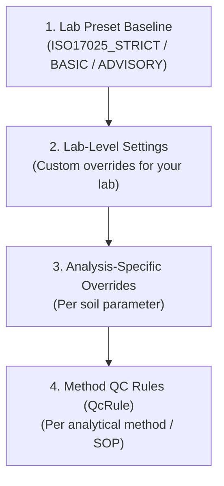

# Per-Lab Settings, Presets & Method Overrides

SoilFER LIMS is used by many independent soil laboratories—ranging from small advisory labs to nationally accredited ISO/IEC 17025 facilities. Because every laboratory operates under its own quality manual, analytical methods, and staffing structure, **nothing in the laboratory workflow is hard-coded as a single lab's fixed policy**.

Instead, Administrators configure how strict the LIMS should be using:

1. **Laboratory Presets** (`ISO17025_STRICT`, `BASIC`, or `ADVISORY`) as a one-click starting baseline
2. **Laboratory Settings** (`Settings → Laboratory Policy`) to fine-tune individual rules across the whole lab
3. **Analysis-Specific Overrides** for rules that vary by soil parameter (for example, pH vs. Olsen P)
4. **Method QC Rules (`QcRule`)** (`Settings → Analyses & Methods`) for method-specific control limits, calibration requirements, and batch failure actions

---

## 1. Choosing a Laboratory Preset

When setting up a lab (or adjusting your quality posture in **Settings → Laboratory Policy**), you can apply one of three built-in presets and then customize any individual setting afterward.

| Policy Area | `ISO17025_STRICT` (Accredited Labs) | `BASIC` (Routine Production Labs) | `ADVISORY` (High-Throughput / Advisory Labs) |
| :--- | :--- | :--- | :--- |
| **QC Enforcement (`qc.mode`)** | `REQUIRED_BLOCKING` — QC failures block batch review until resolved | `REQUIRED_WARN` — QC is evaluated and warns, but does not hard-block | `ADVISORY` — QC is optional and informational only (can also be set to `OFF`) |
| **Max Samples per Batch (`qc.maxBatchSize`)** | `20` samples | `40` samples | Unlimited (`null`) |
| **Method Blanks (`qc.blankPerBatch`)** | `1` per batch | `1` per batch | `0` |
| **Analytical Duplicates (`qc.duplicateEvery`)** | `1` per `10` samples | `1` per `20` samples | `0` |
| **In-House Control / LRM (`qc.lrmPerBatch`)** | `1` per batch | `0` | `0` |
| **Certified Reference / CRM (`qc.crmEveryNBatches`)** | `1` every `10` batches | `0` | `0` |
| **Continuing Calibration / CCV (`qc.ccvEvery`)** | `1` per `10` samples | `1` per `20` samples | `0` |
| **LRM Limit Mode (`qc.lrmLimitMode`)** | `CONTROL_CHART` ($\bar{x} \pm 2s / 3s$ after 20 points) | `FIXED_WINDOW` | `FIXED_WINDOW` |
| **Westgard Rules (`qc.westgardRules`)** | Reject: `1-3s`, `2-2s`, `R-4s` Warn: `1-2s` Review: `4-1s`, `10x` | Reject: `1-3s` Warn: none Review: none | None |
| **Reported Value Rule (`results.reportedValueRule`)** | `MEAN_IF_WITHIN_R` (average of valid replicates within $r$) | `MEAN_IF_WITHIN_R` | `LATEST_VALID` (most recent valid attempt) |
| **Between LOD & LOQ (`results.betweenLodLoq`)** | `REPORT_LT_LOQ` (reports as `< LOQ`) | `REPORT_LT_LOQ` | `REPORT_VALUE_FLAGGED` (reports numeric value with `J` flag) |
| **Max Attempts Before NCR (`repeats.maxAttemptsBeforeNcr`)** | `3` attempts | `5` attempts | `0` (no automatic NCR prompt) |
| **Second-Person Review (`review.secondPersonRequired`)** | `true` (analyst cannot approve own work) | `true` | `false` |
| **Second-Person Amendment (`report.amendmentRequiresSecondPerson`)** | `true` (scientific amendments need 2nd person) | `true` | `false` |
| **Post-Report Retention (`sample.retentionDaysAfterReport`)** | `90` days | `60` days | `30` days |
| **Bench Idle Lock (`bench.idleLockMinutes`)** | `5` minutes | `15` minutes | `0` (disabled) |
| **Bench PIN at Record (`bench.pinAtRecord`)** | `true` (requires PIN on shared terminals) | `false` | `false` |

---

## 2. Applying or Customizing Lab Settings

### What You See

In **Settings → Laboratory Policy**, settings are grouped into clear functional tabs (Quality Control, Results & Plausibility, Repeats & Review, Prep Gates & Equipment, Numbering & Retention, Bench Terminals, and Certificates of Analysis).

Next to each setting you see:
- Its **current active value**
- Whether it matches your selected **Preset** or has a **Custom Lab Override** badge
- Whether individual **Analyses** or **Methods (`QcRule`)** override that setting

### What You Do

1. To switch your baseline preset, select **`ISO17025_STRICT`**, **`BASIC`**, or **`ADVISORY`** at the top of the page, or edit any individual setting field directly.
2. Enter a clear **Reason for Policy Change** at the bottom of the form (for example, *"Updated duplicate frequency from 1-in-20 to 1-in-10 per 2026 Quality Manual rev 4"*).
3. Click **Save Policy Changes**.

### What Happens Next

- **Compatibility Check**: Before saving, the LIMS checks whether your new lab-level setting conflicts with any existing per-method `QcRule` (for example, if you set `qc.mode` to `REQUIRED_BLOCKING`, it warns if an active wet-chemistry method has no control limits configured).
- **Audit Trail**: Every policy change—including the previous value, new value, user, timestamp, and reason—is permanently recorded in the Audit Log.
- **Immediate Effect on New Work**: New batches, runs, and reviews immediately use the updated settings, while already-approved batches and issued reports retain the policy snapshot under which they were approved.

---

## 3. Complete Reference of Configurable Lab Settings

### A. Quality Control (`qc.*`)

| Setting Key | What It Controls | Options / Range |
| :--- | :--- | :--- |
| `qc.mode` | How batch QC outcomes affect workflow progression | `REQUIRED_BLOCKING`, `REQUIRED_WARN`, `ADVISORY`, `OFF` |
| `qc.requireBatchQc` | Whether a method requires QC batches before results can be submitted | `AUTO` (wet chemistry / instrumentation requires QC; physical observation does not), `REQUIRED`, `NOT_REQUIRED` *(overridable per analysis)* |
| `qc.maxBatchSize` | Maximum customer samples allowed in one analytical batch | `1`–`500` or `null` (unlimited) *(overridable per analysis)* |
| `qc.blankPerBatch` | Minimum Method Blanks (`BLANK`) required per batch | `0`–`10` *(overridable per analysis)* |
| `qc.duplicateEvery` | Insert 1 Analytical Duplicate (`DUPLICATE`) per $N$ unknown samples (`0` = disabled) | `0`–`100` *(overridable per analysis)* |
| `qc.lrmPerBatch` | Minimum In-House Reference Materials (`LRM`) required per batch | `0`–`10` *(overridable per analysis)* |
| `qc.crmEveryNBatches` | Insert 1 Certified Reference Material (`CRM`) every $N$ batches (`0` = disabled) | `0`–`1000` *(overridable per analysis)* |
| `qc.ccvEvery` | Insert 1 Continuing Calibration Verification (`CCV`) per $N$ samples (`0` = disabled) | `0`–`100` *(overridable per analysis)* |
| `qc.calibrationVerification` | Require calibration curve ($r$, slope, intercept) and `ICV` / `CCV` / `CCB` verification in each run | `true` / `false` *(overridable per analysis)* |
| `qc.calibrationFailAction` | Action when an `ICV`, `CCV`, or `CCB` fails | Per check (`ICV`, `CCV`, `CCB`): `FAIL_BATCH`, `REPEAT_BRACKET`, or `WARN` *(overridable per analysis)* |
| `qc.failAction` | Action when a batch `BLANK`, `DUPLICATE`, `LRM`, or `CRM` fails | Per type: `FAIL_BATCH` or `WARN` *(overridable per method)* |
| `qc.lrmLimitMode` | How LRM control limits are evaluated | `CONTROL_CHART` ($\bar{x} \pm 2s/3s$ after `controlChartMinPoints`), `FIXED_WINDOW` (recovery % or min/max) *(overridable per analysis)* |
| `qc.controlChartMinPoints` | Minimum historical QC points before switching from fixed limits to Shewhart $\bar{x}/s$ limits | `5`–`200` (default `20`) *(overridable per analysis)* |
| `qc.westgardRules` | Which Westgard rules (`1-3s`, `2-2s`, `R-4s`, `1-2s`, `4-1s`, `10x`) trigger `reject`, `warn`, or `review` | Configurable arrays for `reject`, `warn`, and `review` |
| `qc.blankLimitMode` | How method blank pass/fail is evaluated | `ABSOLUTE` ($\le$ `blankMaxAllowed`), `LT_LOQ` ($<$ LOQ), `LT_HALF_LOQ` ($< 0.5 \times$ LOQ) *(overridable per analysis)* |
| `qc.blankMaxAllowed` | Maximum absolute concentration allowed in a Method Blank | Numeric (default `0.05`) *(overridable per analysis)* |
| `qc.blankHistoryWindow` / `qc.blankHistoryMinPoints` | Rolling window (`20`) and minimum points (`10`) used to compute empirical blank LOD ($3s$) and LOQ ($10s$) | `3`–`500` *(overridable per analysis)* |
| `qc.blankLodMultiplier` / `qc.blankLoqMultiplier` | Standard deviation multipliers for blank-derived LOD and LOQ | Default `3` (LOD) and `10` (LOQ) *(overridable per analysis)* |
| `qc.controlMinRecovery` / `qc.controlMaxRecovery` | Acceptable recovery window (%) for LRM/CRM when using recovery mode | Default `90`% – `110`% *(overridable per analysis)* |
| `qc.crmMode` | How CRM acceptance is evaluated | `RECOVERY` (% of certified value) or `ABS_WINDOW` (within certified uncertainty window) *(overridable per analysis)* |
| `qc.duplicateMode` | How duplicate agreement is evaluated above the near-LOQ threshold | `RPD` (Relative Percent Difference %) or `ABS_DIFF` (absolute difference) *(overridable per analysis)* |
| `qc.duplicateMaxRpd` | Maximum RPD (%) allowed between sample and duplicate above `duplicateNearLoqMultiplier × LOQ` | Default `10`% *(overridable per analysis)* |
| `qc.duplicateNearLoqMultiplier` | Multiplier ($N \times \text{LOQ}$) below which absolute difference is used instead of RPD | Default `5` ($5 \times \text{LOQ}$) *(overridable per analysis)* |
| `qc.duplicateAbsMax` / `qc.duplicateAbsMaxBelow5LOQ` | Maximum absolute difference allowed between duplicates (general or when $< 5 \times \text{LOQ}$) | Numeric or `null` (defaults to $\text{LOQ}$ when near LOQ) *(overridable per analysis)* |
| `qc.ccvMin` / `qc.ccvMax` | Acceptable recovery window (%) for Continuing Calibration Verification (`CCV`) | Default `90`% – `110`% *(overridable per analysis)* |
| `qc.curveMinPoints` / `qc.curveMinR` | Minimum calibration standards (`5`) and correlation coefficient $r$ (`0.995`) | `1`–`20` points; $r \in [0, 1]$ *(overridable per analysis)* |
| `qc.repeatabilityLimit` | Method repeatability limit $r$ for replicate agreement | Numeric or `null` *(overridable per analysis)* |
| `qc.runProfiles` | Rack and plate layouts available in the Batch Builder | Configurable map (defaults include `MICROPLATE_96` 8×12, `CENTRIFUGE_24` 4×6, `RACK_40` 4×10) |
| `qc.reviewedTranscriptionCorrectionEnabled` | Allow bounded transcription corrections on `REVIEWED` batches before final approval | `true` / `false` (default `false`) |

### B. Results, Replicates & Plausibility Checks (`results.*` & `crossCheck.*`)

| Setting Key | What It Controls | Options / Range |
| :--- | :--- | :--- |
| `results.replicatesRequired` | Number of routine measurements required per sample (`1` = single, `2` = duplicate measurements) | `1` or `2` *(overridable per analysis)* |
| `results.reportedValueRule` | How the Reported Value is chosen when multiple valid attempts or replicates exist | `MEAN_IF_WITHIN_R` (average if within repeatability $r$), `LATEST_VALID` (latest valid attempt), `REVIEWER_PICKS` (reviewer must manually select) *(overridable per analysis)* |
| `results.betweenLodLoq` | How values between LOD and LOQ are displayed on reports | `REPORT_LT_LOQ` (censored as `< LOQ`) or `REPORT_VALUE_FLAGGED` (numeric value with `J` flag) *(overridable per analysis)* |
| `results.phMin` / `results.phMax` | Hard physical plausibility bounds for pH | Default `2` – `14` *(overridable per analysis)* |
| `results.typicalMin` / `results.typicalMax` | Typical regional soil range per analysis (triggers soft warning when exceeded) | Numeric or `null` *(overridable per analysis)* |
| `results.calibrationMax` | Upper concentration limit of the calibration curve (above this requires dilution) | Numeric or `null` *(overridable per analysis)* |
| `crossCheck.basesCecFactor` | Warn if $\sum(\text{Ca} + \text{Mg} + \text{K} + \text{Na}) > \text{factor} \times \text{CEC}$ | Default `1.1` ($110\%$) |
| `crossCheck.baseSaturationMaxPct` | Warn if Base Saturation exceeds this percentage | Default `100`% |
| `crossCheck.textureClosureTolerancePct` | Allowed deviation from $100\%$ for $\text{Sand} + \text{Silt} + \text{Clay}$ | Default `2`% ($98\%–102\%$) |
| `crossCheck.cnMin` / `crossCheck.cnMax` | Typical C:N ratio window ($\text{OC} / \text{Total N}$) before flagging for review | Default `8` – `25` |
| `crossCheck.carbonatePhMin` | Minimum pH expected when measurable $\text{CaCO}_3$ is reported | Default `7.0` |

### C. Repeats, Review, Prep Gates & Equipment

| Setting Key | What It Controls | Options / Range |
| :--- | :--- | :--- |
| `repeats.maxAttemptsBeforeNcr` | Maximum analytical attempts allowed on a work item before an NCR is required (`0` = disabled) | `0`–`20` *(overridable per analysis)* |
| `repeats.technicianSelfRepeatBeforeSubmit` | Allow technicians to create a self-repeat attempt (`R2`) before submitting the batch | `true` / `false` |
| `review.secondPersonRequired` | Block a user from reviewing or approving a batch or result they recorded themselves | `true` / `false` |
| `gate.verificationRequired` | Require a second-person verification sign-off on `DRYING` or `PREPARATION` gates | `true` / `false` (can be set for `DRYING` and `PREPARATION` individually) |
| `equipment.requireEquipment` | Whether methods require linked instruments before recording results | `AUTO`, `REQUIRED`, `NOT_REQUIRED` *(overridable per analysis)* |
| `equipment.unconfiguredReadiness` | Action (`BLOCK`, `WARN`, `ALLOW`) by criticality (`CRITICAL`, `IMPORTANT`, `NON_CRITICAL`) when an instrument is not ready | Default: `{ CRITICAL: 'BLOCK', IMPORTANT: 'WARN', NON_CRITICAL: 'ALLOW' }` |
| `referenceMaterials.expiryWarningDays` | Days before CRM/LRM expiration to show an amber warning badge | Default `30` days |
| `pt.zScoreLimits` | $|z|$-score thresholds for Proficiency Testing rounds | Default `{ questionable: 2, unsatisfactory: 3 }` |

### D. Numbering, Bench Terminals & Reports

| Setting Key | What It Controls | Options / Range |
| :--- | :--- | :--- |
| `sample.codeFormat` / `sample.sequenceReset` | Automatic Sample Code format and sequence reset schedule | Default `'{LAB}-{YY}-{SEQ:6}{CHK}'`, reset `YEARLY` or `NEVER` |
| `container.codeFormat` / `container.sequenceReset` | Sub-sample container barcode format | Default `'C-{LAB}-{YY}-{SEQ:6}{CHK}'`, reset `YEARLY` or `NEVER` |
| `consignment.numberFormat` / `consignment.sequenceReset` | Intake consignment number format | Default `'CSG-{LAB}-{YYYY}-{SEQ:5}'`, reset `YEARLY` or `NEVER` |
| `report.numberFormat` | Official Certificate of Analysis report number format | Default `'RPT-{LAB}-{YYYY}-{SEQ:5}'` (`LAB` scope) |
| `sample.retentionDaysAfterReport` | Default days to retain archived soil after reporting before disposal eligibility | `0`–`3650` days |
| `intake.defaultAnalysisMassG` / `intake.retentionMassG` | Default mass (g) required per test (`10` g) plus archive retention (`100` g) at intake | Numeric (grams) |
| `bench.idleLockMinutes` | Minutes of inactivity before a shared bench terminal locks (`0` = disabled) | `0`–`480` minutes |
| `bench.pinAtRecord` | Prompt for operator 4–6 digit PIN when recording measurements on a shared bench terminal | `true` / `false` |
| `numbers.decimalSeparator` / `numbers.thousandsSeparator` | Decimal point (`'.'` or `','`) and optional thousands separator used on bench inputs and PDFs | `'.'` or `','` |
| `report.amendmentRequiresSecondPerson` | Require a second Reviewer/Manager to authorize a post-report scientific amendment | `true` / `false` |
| `report.amendedStatement` | Custom 5-language statement printed on amended reports (supports `{replacedNumber}`, `{replacedRevision}`, `{reason}`) | Custom locale map or `null` (uses built-in ISO 17025 wording) |
| `report.uncertaintyMode` / `report.uncertaintyCoverageFactor` | Whether expanded measurement uncertainty ($U$, e.g. $k=2$) is printed alongside results | `NOT_REPORTED`, `EXPANDED_ABSOLUTE`, `EXPANDED_RELATIVE_PCT` *(overridable per analysis)* |
| `report.ovenDryConvertible` | Whether an analysis can be converted from air-dry to oven-dry basis using sample moisture | `true` / `false` *(overridable per analysis)* |

---

## 4. Per-Analysis & Per-Method (`QcRule`) Overrides

Many quality settings depend on the specific analytical test. For example, your lab may run **pH (1:2.5 $\text{H}_2\text{O}$)** with duplicate absolute difference limits ($\pm 0.10$ pH units) and no calibration curve, while running **Mehlich-3 Phosphorus** with a 6-point calibration curve ($r \ge 0.998$), a Method Blank $< 0.05\text{ mg/kg}$, and an RPD limit of $10\%$.

### How Precedence Works

Whenever the LIMS evaluates a batch, run, or result for a given analysis and method, it resolves each rule in order from most specific to most general:

1. **Method QC Rule (`QcRule`)** configured on the specific method in **Settings → Analyses & Methods**
2. **Analysis-Specific Policy Override** configured for that parameter in **Settings → Laboratory Policy**
3. **Lab-Level Setting** configured for your laboratory
4. **Active Lab Preset Default** (`ISO17025_STRICT`, `BASIC`, or `ADVISORY`)

> [!TIP]
> You can inspect the exact effective rules that applied to any batch or report at any time: open the batch or report detail view and click **Policy Snapshot** to see the resolved values that were in force when the work was performed.
