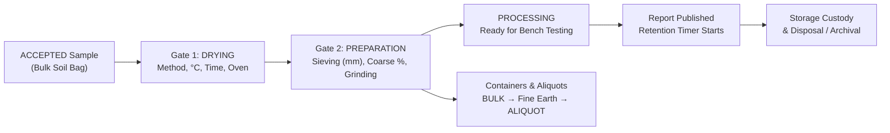

# Sample Preparation, Containers, Storage & Custody

Before a soil sample can be analyzed at the bench, it must be properly dried and prepared, sub-sampled into labeled containers or aliquots if needed, and tracked across storage locations until its retention period expires.

---

## Visual Overview: From Bulk Bag to Storage & Disposal

---

## 1. Operational Prerequisite Gates: Drying & Preparation

SoilFER-LIMS enforces **preparation gates** so that technicians cannot record wet chemistry or spectroscopy results on an undried or unsieved sample.

### Step A: Recording Sample Drying (`DRYING`)
- **What you see**: In the Technician Workbench or Sample Detail page, an `ACCEPTED` sample shows a required **DRYING** operational gate. Analytical worksheets remain locked (`DRYING_PREREQUISITE_BLOCKED`) until drying is confirmed.
- **What you do**:
  1. Open the **DRYING** task for the sample.
  2. Check off the operational checklist steps (for example: *Identity verified*, *Spread on drying tray*, *Dried to constant mass*).
  3. Fill in the **Structured Drying Record**:
     - **Drying Method**: Choose `AIR` (air drying), `OVEN_40` (forced-air oven at 40 °C), `OVEN_105` (oven at 105 °C), or `OTHER`.
     - **Temperature (°C)**: Enter the actual drying temperature (required; between `-20 °C` and `250 °C`).
     - **Start & End Time**: Enter when drying started and ended (`endedAt` must be after `startedAt` and cannot be in the future).
     - **Equipment (Optional)**: Select the in-service drying oven from your laboratory's equipment list.
     - **Mass Before & Mass After (Optional, in `g`)**: Record wet and dry mass if weighed.
  4. Click **Confirm Complete**.
- **What happens next**:
  - SoilFER-LIMS saves an immutable `PreparationRecord` linked to the confirmation receipt, calculates the exact drying duration in hours and minutes, and marks `DRYING` complete.
  - These structured drying details (method, temperature, duration, equipment asset tag, and analyst) automatically print on the final PDF Certificate of Analysis.

### Step B: Recording Sample Preparation (`PREPARATION`)
Each laboratory configures which physical preparation steps are active in its workflow (`SIEVING`, `GRINDING`, and/or `SPLITTING`).

- **What you see**: Once `DRYING` is complete, the **PREPARATION** gate opens and asks for a structured record for each active step in your laboratory.
- **What you do**:
  1. Open the **PREPARATION** task and complete the checklist.
  2. For each required step configured by your laboratory:
     - **Sieving (`SIEVING`)**: Enter the **Sieve Mesh Size (`sieveMm`, e.g. `2` mm)**, **Total Mass Before Sieving (`massBeforeG`, in `g`)**, and **Coarse Fraction / Stones Mass (`coarseFractionG`, in `g`)**.
     - **Grinding (`GRINDING`, if active in your lab)**: Enter the **Target Grind Fineness (`grindMm`, e.g. `0.5` mm or `0.15` mm)**.
     - **Splitting (`SPLITTING`, if active in your lab)**: Enter the start/end timestamps and optional masses or divider equipment.
     - **Equipment (Optional)**: Select an active (`IN_SERVICE`) sieve shaker, mill, or riffle splitter belonging to your laboratory.
  3. Click **Confirm Complete**.
- **What happens next**:
  - For sieving, SoilFER-LIMS automatically calculates the **Coarse Fraction Percentage**:
    $$\text{Coarse Fraction \%} = \frac{\text{Coarse Fraction Mass (g)}}{\text{Mass Before Sieving (g)}} \times 100\%$$
  - If your laboratory policy enables `gate.verificationRequired` (off by default across all presets, configurable per lab or per gate), a second person or manager verifies the gate before it closes.
  - When the final preparation gate finishes, the sample automatically advances from `ACCEPTED` to `PROCESSING`, unlocking all assigned analytical worksheets.

### What If a Preparation Step Must Be Reverted?
If a technician or manager discovers that a sample was marked prepared by mistake (for example, it needs additional drying or re-sieving):
- Reopening/reverting a completed preparation gate requires a **mandatory reason** and creates an immutable `ResultEvidenceEvent` (`PREP_REVERTED`).
- Existing analytical measurements are preserved, but the sample is blocked from submission, manager approval, and report publication until a **Lab Manager** reviews the situation and explicitly clears the `PREP_REVERTED` flag with a recorded reason.

---

## 2. Residual Moisture & Oven-Dry Report Basis

Most routine soil tests are weighed on **air-dry (or 40 °C dried) fine earth**, while some laboratories or clients require chemical results to be reported on an **oven-dry (105 °C) mass basis**.

- **Recording Gravimetric Soil Moisture**: When a technician runs the `SOIL_MOISTURE` analysis using the server-side `GRAVIMETRIC_MOISTURE` calculation template (entering tare tin mass, air-dry soil + tin mass, and 105 °C oven-dry soil + tin mass), SoilFER-LIMS computes and freezes both the gravimetric water content (%) and the **Moisture Correction Factor** ($f_{\text{moisture}} > 1.0$).
- **Configurable Per-Analysis Conversion (`report.ovenDryConvertible`)**:
  - In **Settings → Laboratory Policy**, each lab configures which analyses can be converted from air-dry to oven-dry basis (`report.ovenDryConvertible`, off by default; intensive properties like `pH` or `SOIL_MOISTURE` itself are never converted, and `< LOQ` censored values stay `< LOQ`).
  - When a report is generated on an `OVEN_DRY` basis, the system multiplies eligible uncensored air-dry concentrations (and their expanded uncertainty) by the frozen moisture correction factor, rounds to the method's configured decimal places, and prints the exact moisture factor and source moisture result ID on the PDF report.

---

## 3. Physical Containers & Aliquots

During preparation and testing, one field bag is often split into several physical vessels: a bulk bag, a 2 mm fine-earth jar, a finely ground sub-sample for spectroscopy/CNS, an analytical **aliquot** weighed out for an extraction, or an archive jar.

### What You See
- On the **Sample Detail** page, the **Containers & Aliquots** panel shows a visual family tree of all physical containers created from the sample, their issued container codes, masses, and any analytical attempts linked to them.

### What You Do
1. Open the sample and go to **Containers & Aliquots**.
2. Click **Add Container**.
3. If this is the first container, create the root **Bulk (`BULK`)** container. To create a child container (such as Fine Earth, Ground Material, **Aliquot (`ALIQUOT`)**, or Archive), select its active parent container from the same sample.
4. Optionally enter the container's net mass (`g`) and click **Create**.
5. Print a **Standard** or **Compact** QR/Code128 label for the new container using **Print Labels**.

### What Happens Next
- SoilFER-LIMS allocates an immutable container code using your laboratory's configured `container.codeFormat` and `container.sequenceReset` policy (default `C-{LAB}-{YY}-{SEQ:6}{CHK}`, such as `C-GTM-26-000018R`).
- When a technician records an analytical run or reserves a repeat in the **Workbench**, they can select which specific **Aliquot (`ALIQUOT`)** from that sample was measured. Once an attempt is recorded, its aliquot link is permanently frozen for full traceability.

---

## 4. Storage Locations, Chain of Custody & Retention

Every physical hand-off and storage move is recorded in an append-only **Chain of Custody** ledger.

### Moving Samples & Recording Custody Events
- **Separate Sample vs. Reagent Storage**: In **Equipment & Inventory → Locations**, storage locations are tagged by purpose: `SAMPLE` (cold rooms, drying racks, archive shelves) vs. reagent/consumable storage. Samples can only be moved into active `SAMPLE` locations belonging to your laboratory.
- **What you see**: On the **Sample Detail → Custody & Storage** tab, you see the sample's current storage location and the chronological history of every custody event from physical receipt onward.
- **What you do**:
  1. Click **Record Custody / Move Sample**.
  2. Choose the movement type:
     - `MOVED` or `RETURNED`: Select the target **Sample Storage Location** in your laboratory (and optionally select specific containers).
     - `ISSUED` or `SENT_OUT`: Enter the **Counterparty** (who received the material, such as a partner lab or researcher) and reference note.
  3. Click **Save Custody Event**.
- **What happens next**: An immutable custody row is appended with your username, timestamp, source/destination, and reference, updating the sample's current location.

### Sample Retention & Safe Disposal
How long must your laboratory keep soil bags after issuing a report?

- **Configurable Retention Policy (`sample.retentionDaysAfterReport`)**:
  - Each laboratory sets its default retention period in **Settings → Laboratory Policy** (shipped preset defaults: **90 days** in `ISO17025_STRICT`, **60 days** in `BASIC`, **30 days** in `ADVISORY`).
  - Individual projects can also override this setting (`retentionDaysAfterReport` in **Project Settings**) if a contract requires longer or shorter storage.
- **Automatic Retention Timer**: When a sample's Certificate of Analysis is published, SoilFER-LIMS calculates and records the sample's exact `retainUntil` date.
- **Disposal Queue & Archival**:
  - **What you see**: Once `retainUntil` has passed, eligible `APPROVED` or `ARCHIVED` samples—provided they have **no open report amendment** and **no active sample hold**—appear in the **Disposal Queue** on the **Samples** page.
  - **What you do**: A manager reviews overdue samples and either moves them to long-term **Archive (`ARCHIVED`)** (selecting a controlled archive storage location) or authorizes **Disposal (`DISPOSED`)** with a recorded reason.Samples rejected at intake (`RECEIVED_REJECTED`) can be disposed of immediately with a reason.
  - **What happens next**: Once a sample is `DISPOSED`, its analytical history and reports remain permanently available in LIMS, while physical actions (new containers, custody moves, or retests) are locked.
