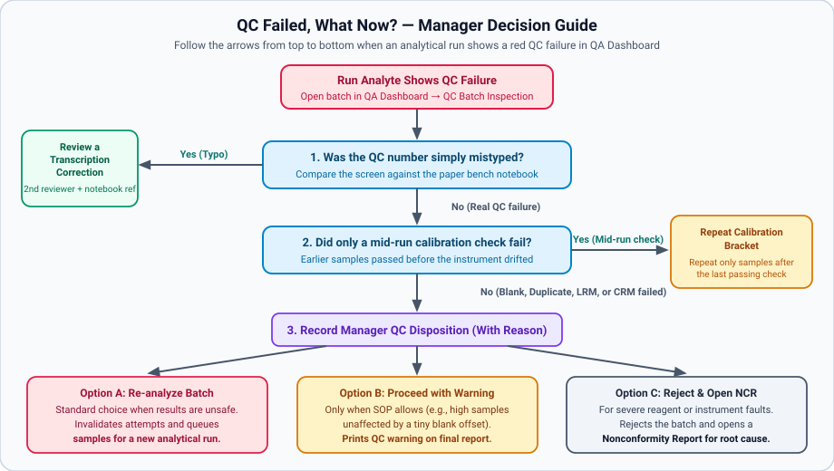

# Quality Control, Control Charts & Failed QC

## What This Is For

Monitor daily quality control across your laboratory in **QA Dashboard**. This page explains what *blanks*, *duplicates*, and *reference soils* check in every analytical run (see [Glossary](../reference/glossary.md)) and shows what to do whenever a batch fails quality control.

| What do you need to do? | Open this task page |
|---|---|
| Decide what to do when a batch fails quality control (**Re-analyze Batch**, **Repeat calibration bracket** (re-test only the samples measured between the last good instrument check and the failed check), or **Proceed with Warning**) | [What to Do When a QC Run Fails (Batch Disposition & Bracket Repeats)](../qc/handle-failed-qc-batch.md) |
| Propose or approve **Control charts** limits, manage **Reference Materials**, or review **LOD/LOQ proposals from method blanks** (proposed limit of detection and limit of quantification (lowest detectable and lowest reliably measurable amounts) calculated from blank runs) | [Review Control Charts, Reference Materials, and Blank Limits](../qc/control-charts-and-blank-limits.md) |
| Investigate **Nonconformities** (problem records), log **Proficiency testing** rounds, or inspect **System Audit Logs** | [Manage Nonconformities, Proficiency Testing, and Audit Logs](../qc/nonconformities-pt-and-audit-log.md) |
| Enter blank, duplicate, and reference soil readings at the bench | [Technician: Workbench & Analytical Runs](technician-workbench.md) |

> *Screenshot placeholder — docs/book/src/img/screenshots/qa-dashboard-overview.png (screenshot coming once the training data is ready): The **QA Dashboard** showing **Lab overview**, **Batches awaiting disposition**, **Open NCRs**, **QC failure rate by analyte**, and the **QC Batch Inspection** modal.*

---

## Before You Start

- Sign in with a **Laboratory Manager** account on the **Sign in to SoilFER LIMS** screen. You need manager permission to record batch decisions, approve control chart limits, or close problem records.
- Technicians can view quality control results and enter run observations in **Workbench**.

---

## Steps

### 1. Check What Each Quality Control Sample Does in a Run

Every analytical run in **Workbench** includes quality control positions alongside routine soil samples:

| QC Position | Plain-Language Job | What Happens If It Fails |
|---|---|---|
| **Blank** (method blank) | Pure water and reagents with no soil; checks that glassware and chemicals are clean | Flags the run analyte as failed so contaminated numbers are not reported |
| **Duplicate** / **Duplicate pair** | A second weighing of the same soil sample in the run; checks whether the method gives repeatable numbers | Flags the run analyte and asks the analyst or manager to check precision |
| **Laboratory reference material** (check soil) | A large jar of well-mixed house soil measured in every batch; tracks day-to-day stability on **Control charts** | Flags a warning (outside 2 standard deviations) or a failure (outside 3 standard deviations) |
| **Certified reference material** (official standard soil with a certified value) | A soil standard with an official certified concentration; checks method accuracy | Flags the run analyte as failed and opens a record in **Nonconformities** |
| Calibration checks (ICV, CCV, CCB) | Standard solutions measured at the start and middle of an instrument run to spot drift | Allows a **Repeat calibration bracket** so only samples after the last good check need repeating |

### 2. Check Your Daily Quality Health in **QA Dashboard**

1. Click **QA Dashboard** in the left menu.
   *You should see **Quality Assurance & Audit** open on the **Lab overview** tab.*
2. Check the top summary cards for **Batches awaiting disposition**, **Open NCRs** (open problem records), expiring reference materials, and **Calibration due**.
3. If **Batches require disposition** is greater than zero, click the **QC Batches** tab (or **QC Exceptions** in **Manager Task List**). Click **Inspect** on the failed batch.
4. Follow the decision diagram above to resolve the failed batch (see [What to Do When a QC Run Fails](../qc/handle-failed-qc-batch.md)).

---

## What Happens Next

- Once you record a batch decision in **QC Batch Inspection**, the affected sample tests are queued for a fresh analytical run (**Re-analyze Batch** / **Repeat calibration bracket**). If you chose **Proceed with Warning**, downstream sample review is unblocked with a documented warning.
- All quality control evaluations, control chart limits, and manager decisions remain permanently viewable in **QA Dashboard** and on the sample's **Review** tab.

---

## If Something Goes Wrong

- *If a technician cannot approve or submit samples because of* **Failed batch QC requires a manager disposition.** (a manager must record a decision on the failed batch before results can be approved) *→* Open **QA Dashboard**, click **Inspect** on the failed batch, and complete **Record Manager QC Disposition** (save the manager's decision on a failed batch).
- *If a duplicate check on a very low nutrient soil passed even though the percentage difference looked large →* Near the detection limit (below 5 times the limit of quantification), SoilFER LIMS checks the absolute difference between the two readings instead of the percentage difference.
- *If only one element in a multi-element ICP run failed QC →* Verdicts are per analyte. You can approve and report the passing elements right away while repeating only the failed element.

---

## For the QA Person

- *Configurable laboratory starting rule sets*: In **Policies**, laboratories choose between three starting rule sets (**ISO 17025 strict**, **Basic**, or **Advisory**). You can also fine-tune rules per method under **Versioned QC rules**.
- *Two-person Shewhart Control Charts & Westgard rules*:
  - New **Laboratory reference material** (your lab's own in-house check soil) lots start in **Provisional** (**Fixed window**) mode until at least **Minimum baseline points** (default 20) are recorded.
  - A manager reviews the candidate points in **Control charts**, gives an **Exclusion reason** for any outlier, and clicks **Propose limits**. A second manager (**Approval requires a different named user.**) clicks **Approve limits** to freeze the mean and standard deviation.
  - Evaluated Westgard rules flag rejections (1-3s, 2-2s, R-4s), warnings (1-2s), and drift **QC review obligations** (4-1s, 10x).
- *Blank-history detection and quantification limit proposals*: In **Reference Materials** under **LOD/LOQ proposals from method blanks** (proposed limit of detection and limit of quantification — lowest detectable and lowest reliably measurable amounts), managers review recent method blanks. Failed blanks stay included unless unchecked with an **Exclusion reason**. Click **Record proposal** to save the calculated limits for method review.
