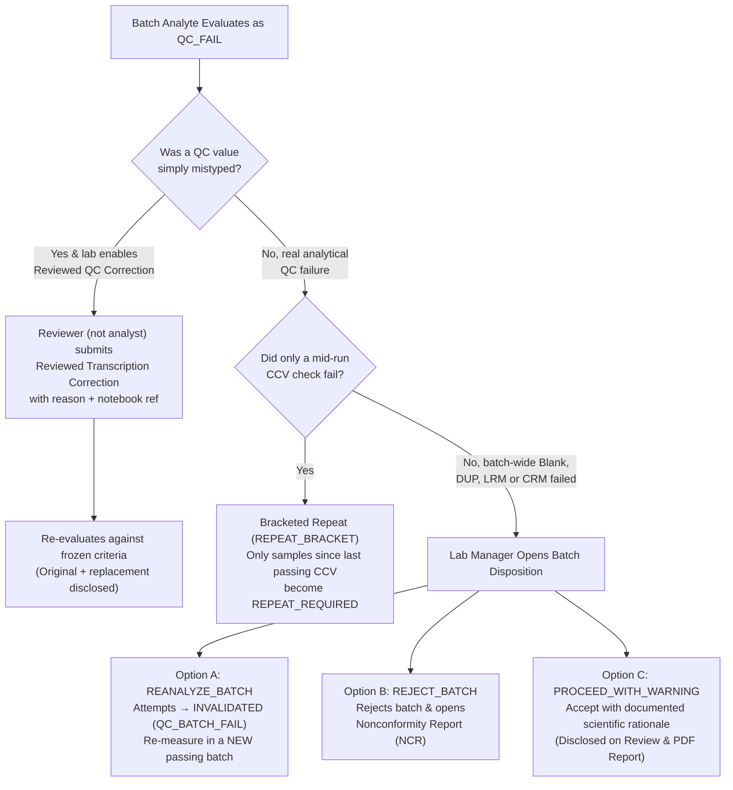

# Quality Control, Batches & What to Do When QC Fails

SoilFER-LIMS is built to support daily laboratory quality assurance and quality control (QA/QC) aligned with **ISO/IEC 17025 (§7.7 & §7.10)** and **FAO GLOSOLAN QA/QC guidelines**.

Because SoilFER-LIMS is used by many different laboratories—from accredited national reference centres to university teaching labs and regional field stations—**every QC frequency, acceptance limit, and blocking rule is configurable per laboratory and per analytical method**. The software provides sensible starting presets (`ISO17025_STRICT`, `BASIC`, and `ADVISORY`), and each laboratory validates and approves its own method-specific rules.

---

## 1. How Analytical Batches (Runs) Work

An **Analytical Batch (Run)** is the basic unit of quality control in SoilFER-LIMS:
- A batch groups routine samples measured together under **one method**, **one instrument**, and **one analyst session**, up to your laboratory's configured maximum batch size (`maxBatchSize`, default `20` in `Strict`, `40` in `Basic`, or unlimited in `Advisory`).
- **QC positions are real members of the run**: Blanks, duplicates, reference soils (LRMs), certified reference materials (CRMs), and calibration checks (ICV/CCV/CCB) sit inside the run sequence alongside routine samples and are entered directly in the Workbench grid.
- **QC Verdicts Are Per Analyte**: If a multi-element run (such as ICP-OES covering `Ca`, `Mg`, `K`, and `Na`) passes QC for `Ca`, `Mg`, and `Na` but fails `K`, only `K` is marked `QC_FAIL`. You can approve and report the passing analytes without re-running the entire multi-element batch.
- **Empty Start & Frozen Rules**: Every QC input cell starts blank (never pre-filled with passing defaults). When a run starts, SoilFER-LIMS freezes the resolved QC rules, reference material values, and control-chart limits for that run so later policy edits never retroactively alter past runs.

---

## 2. QC Elements in SoilFER-LIMS

The table below shows each QC element supported in SoilFER-LIMS, its shipped default under the `ISO17025_STRICT` preset (all configurable per lab and per method via **Settings → Laboratory Policy** and **Admin → QC Rules**), and what happens when it fails:

| QC Element | What It Checks | Shipped Default Frequency (`Strict` Preset) | Shipped Default Acceptance Rule (Configurable per Lab & Method) | What Happens on Failure |
| :--- | :--- | :--- | :--- | :--- |
| **Method Blank (`MB`)** | Checks reagents, water, glassware, and instruments for background contamination. | 1 per batch at start (configurable; e.g. 2 for batches > 20) | $\|\text{Measured}\| < \text{LOQ}$ of the method (or configured threshold / $\frac{1}{2}\text{LOQ}$) | Analyte in batch becomes `QC_FAIL`. Re-analyze in a new batch, or manager dispositions with reason if samples are unaffected (e.g. $> 10\times$ blank). |
| **Analytical Duplicate (`DUP`)** | Checks within-batch repeatability (precision) by analyzing a second replicate of a real sample in the run. | 1 per 10 samples, minimum 1 per batch (`1 per 20` in `Basic`, `Off` in `Advisory`) | • When both readings $\ge 5\times\text{LOQ}$: $\text{RPD} \le \text{limit}$ (or method $\|\Delta\|$, e.g. pH $\le 0.2$, texture $\le 3\%$)<br/>• When near detection limit ($< 5\times\text{LOQ}$): **Absolute difference** $\|\Delta\| \le \text{LOQ}$ | Failing duplicate flags the batch/analyte `QC_FAIL` (or sample-level warning if configured) and marks the sample's attempt for review/third replicate. |
| **Laboratory Reference Material (`LRM` / Check Soil)** | Checks batch-to-batch stability and drift using an in-house homogenised check soil lot. | 1 per batch (`Off` in `Basic` and `Advisory`) | Evaluated on a **Shewhart Control Chart** ($\pm 2s$ warning, $\pm 3s$ action) + **Westgard Rules** once $\ge 20$ points are approved; fixed window (`PROVISIONAL_NO_CHART`) before then. | • `1-3s`, `2-2s`, `R-4s` $\rightarrow$ `QC_FAIL`<br/>• `1-2s` $\rightarrow$ `QC_WARN`<br/>• `4-1s`, `10x` $\rightarrow$ Opens a **QA Review Obligation** |
| **Certified Reference Material (`CRM`)** | Checks method trueness/accuracy against a certified standard with known uncertainty. | Every 10th batch (`Off` in `Basic` and `Advisory`; configurable per method) | Configured recovery window (e.g. $90\text{--}110\%$) or certified window | Analyte becomes `QC_FAIL` and automatically opens a **Nonconformity Report (NCR)** in blocking/warning modes. |
| **Calibration Curve** | Verifies linearity of instrumental response (ICP, AAS, UV-Vis, Flame Photometer). | Every instrumental run | Correlation $r \ge 0.995$ with $\ge 5$ calibration points (configurable) | Run cannot be committed until a passing curve is recorded. |
| **Calibration Checks (`ICV`, `CCV`, `CCB`)** | Verifies initial calibration (`ICV`, second source) and checks for instrumental drift (`CCV` + `CCB`) during the run. | `ICV` at start; `CCV` + `CCB` every $N$ samples (default 10) and at the end | `CCV` within recovery window (default $90\text{--}110\%$); `CCB` $< \text{LOQ}$ | **Bracketed Repeat**: Only the samples measured since the last passing `CCV` become `REPEAT_REQUIRED`—not the whole batch. |

### Why Duplicate Checks Switch from RPD to Absolute Difference Near the LOQ
When two duplicate measurements are very small (close to zero or below $5\times\text{LOQ}$), the Relative Percent Difference formula ($\text{RPD} = \frac{|x_1 - x_2|}{\bar{x}} \times 100\%$) divides by a tiny number and produces huge, misleading percentages (for example, `0.02` vs `0.03 mg/kg` is a `40%` RPD even though the `0.01 mg/kg` difference is tiny). SoilFER-LIMS automatically guards against this:
- Whenever either duplicate reading is below $5\times\text{LOQ}$ (or when the mean is zero or negative), SoilFER-LIMS evaluates the pair using the **Absolute Difference ($|\Delta| = |x_1 - x_2| \le \text{LOQ}$ or configured `ABS_DIFF`)** instead of RPD.

### Optional Method Blank Subtraction
Each method can configure `blankCorrection` as `NONE` (default) or `SUBTRACT_MEAN_BLANK`. When blank subtraction is enabled for a method, SoilFER-LIMS preserves both the **raw observation** and the **blank-corrected value** for complete ISO/IEC 17025 §7.5 traceability.

---

## 3. Reference Materials Catalogue (LRMs & CRMs)

Before using a Laboratory Reference Material (LRM / check soil) or Certified Reference Material (CRM) in a run, register its lot in **Admin / Quality → Reference Materials**:

### What You See
- A catalogue of your laboratory's reference material lots showing material type (`CRM` or `LRM`), lot number, expiry date, current status (`ACTIVE`, `QUARANTINED`, `EXPIRED`, `RETIRED`), linked inventory lot (if any), and assigned target values per analyte and method.
- Lots approaching expiration within your laboratory's configured warning window (`referenceMaterials.expiryWarningDays`, default `30 days`) display an amber expiry warning badge.

### What You Do
1. Click **New Reference Material**, enter the material name, type (`CRM` or `LRM`), supplier/certificate reference, lot code, and expiration date.
2. Add the **Assigned Analyte Values** (target value, controlled unit, optional specific methodology, and for CRMs, the certified expanded uncertainty and coverage factor $k$).
3. When starting a run in the Workbench that requires an LRM or CRM, select the active, unexpired Reference Material lot in the run start form. *(For runs using LRM Control Charts, the LRM lot must be bound before the run starts.)*

### What Happens Next
- If you ever need to correct a mistyped reference value on a lot, SoilFER-LIMS requires a mandatory reason, supersedes the old value row while preserving it in history, and never retroactively alters already-started runs.

---

## 4. Shewhart Control Charts & Westgard Rules

For laboratories using **Laboratory Reference Materials (`LRM`)** to monitor day-to-day precision and drift, SoilFER-LIMS builds **Shewhart Control Charts** scoped to each `Laboratory × Analyte × Methodology × Reference Material Lot` series.

```
 Concentration
   +3s (Action)   ─────────────────────────────────────────────── (1-3s Reject)
   +2s (Warning)  - - - - - - - - - - - - - - - - - - - - - - - - (1-2s Warning / 2-2s Reject)
   +1s            · · · · · · · · · · · · · · · · · · · · · · · ·
   Mean (x̄)       ═══════════════════●════●══════════════════════
   -1s            · · · · · · · · · · · · · · · · · · · · · · · ·
   -2s (Warning)  - - - - - - - - - - - - - - - - - - - - - - - -
   -3s (Action)   ───────────────────────────────────────────────
```

### How Control-Chart Limits Are Established and Frozen
Control-chart limits are **never** recalculated automatically after every run. Instead, they follow a deliberate two-person QA workflow:
1. **Provisional Phase (`PROVISIONAL_NO_CHART`)**: While a new LRM lot has fewer than your lab's minimum baseline points (`qc.controlChartMinPoints`, default `20`), runs are evaluated against the rule's provisional fixed window (for example, $\pm 10\%$).
2. **Proposing Control Limits**:
   - **What you see**: Once at least `20` passing, uncensored LRM observations exist for that lot and method, the **Control Charts** panel allows a manager/QA officer to propose statistical limits.
   - **What you do**: Review the candidate points (any statistical outliers are flagged for your attention, never dropped silently). If you exclude an eligible point from the baseline calculation, enter a **mandatory reason** for that exclusion, provide a proposal rationale, and click **Propose Limits**.
3. **Second-Person Approval (`APPROVE_CONTROL_LIMITS`)**:
   - **What you do**: A **second authorized manager** (different from the person who created the proposal) reviews the proposed arithmetic mean $\bar{x}$ and sample standard deviation $s$ ($n - 1$) and clicks **Approve Control Limits**.
   - **What happens next**: The new $\pm 2s$ warning and $\pm 3s$ action limits become the active frozen limit version for future runs on that LRM lot. Already-started runs keep the limits they started with.

### How Westgard Rules Are Evaluated
When a run is evaluated against approved control-chart limits (under the `Strict` preset or your lab's configured `qc.westgardRules`):
- **Reject (`QC_FAIL`)**:
  - **`1-3s`**: One LRM observation falls outside $\pm 3s$.
  - **`2-2s`**: Two consecutive LRM observations fall outside $\pm 2s$ on the same side of the mean.
  - **`R-4s`**: Within the same run and series, the range between two LRM replicates exceeds $4s$.
- **Warning (`QC_WARN`)**:
  - **`1-2s`**: One LRM observation falls between $\pm 2s$ and $\pm 3s$.
- **Drift / Bias Review Obligation (`4-1s` and `10x`)**:
  - Four consecutive points outside $\pm 1s$ on the same side (`4-1s`) or ten consecutive points on the same side of the mean (`10x`) open a **Control-Chart Review Obligation** for the QA Manager to investigate and close as either `NO_ACTION` or `INVESTIGATE_NEW_LIMITS` with a mandatory note.

---

## 5. Blank-History LOD & LOQ Proposals

Over time, your laboratory's method blank measurements provide real evidence of your actual background noise.

- **What you see**: Below the Control Charts panel in **Reference Materials**, the **Blank-History LOD/LOQ Proposal** tool displays the last $N$ evaluated method blanks for a single `Lab × Analysis × Methodology × Revision × Unit` series (configurable per lab and method; default window $N = 20$, minimum $10$).
- **What you do**:
  1. Inspect all blanks in the window (including failed blanks, which are selected by default so bad runs cannot be hidden).
  2. If a specific blank was a documented contamination event that should be excluded, uncheck it and enter a **mandatory exclusion reason**.
  3. Review the calculated **Sample Standard Deviation ($s_{\text{blank}}$)** and the proposed limits:
     $$\text{LOD} = k_{\text{LOD}} \times s_{\text{blank}} \quad (\text{default } 3 \times s_{\text{blank}})$$
     $$\text{LOQ} = k_{\text{LOQ}} \times s_{\text{blank}} \quad (\text{default } 10 \times s_{\text{blank}})$$
  4. Click **Record LOD/LOQ Proposal**.
- **What happens next**: SoilFER-LIMS records an immutable `LOD_LOQ_PROPOSED` entry in the audit log freezing the selected/excluded blank IDs, reasons, $n$, mean, $s_{\text{blank}}$, and proposed LOD/LOQ values for QA review. Recording a proposal never automatically overwrites your active methodology limits.

---

## 6. QC Modes & Step-by-Step: What to Do When QC Fails

How SoilFER-LIMS reacts to a QC failure depends on your laboratory's configured **QC Mode**:
- **Strict / Blocking (`REQUIRED_BLOCKING`, default in `ISO17025_STRICT`)**: Missing or failed QC blocks manager result approval and report publication for that analyte until resolved.
- **Warning (`REQUIRED_WARN`, default in `BASIC`)**: QC is evaluated and prominent warning badges are shown, requiring explicit reviewer acknowledgement (`QC_ACKNOWLEDGEMENT_REQUIRED`), without hard-blocking approval.
- **Advisory / Off (`ADVISORY` / `OFF`, default in `ADVISORY`)**: QC positions are optional and shown for information.

### Step-by-Step: When an Analyte in a Batch Is `QC_FAIL`



#### Step 1: Check Whether the QC Reading Was a Typing Mistake
If the technician simply mistyped the blank or standard reading from their bench notebook, and your laboratory policy has enabled **Reviewed QC Transcription Correction** (`qc.reviewedTranscriptionCorrectionEnabled = true`; off by default):
- **What you see**: On an undispositioned `QC_FAIL` batch analyte, the **Reviewed QC Correction** form opens with empty replacement fields.
- **What you do**: A **Reviewer / Lab Manager**—who **must be a different person** from both the run analyst and the person who entered the QC observation—enters the corrected value, a **mandatory reason**, and the **physical source reference** (such as bench logbook number and page).
- **What happens next**: SoilFER-LIMS appends the replacement measurement, links it to the original reading (`supersededById`), re-evaluates the batch against the original frozen criteria, and discloses both the original failed reading and the reviewed correction in the QC history and PDF report.

#### Step 2: If a Continuing Calibration Verification (`CCV`) Failed
- **What happens automatically**: SoilFER-LIMS identifies only the samples measured after the last passing `CCV` (`REPEAT_BRACKET`) and marks those work items `REPEAT_REQUIRED`. Samples measured earlier in the run (before the last passing `CCV`) remain valid.
- **What you do**: Place the `REPEAT_REQUIRED` samples into a **new analytical run** and re-measure them.

#### Step 3: Apply a Manager Batch Disposition (For Batch-Wide QC Failures)
When a Method Blank, Analytical Duplicate, LRM, or CRM genuinely fails, a **Lab Manager** opens the batch in **Quality Control** and chooses one of three audited dispositions (with a mandatory written rationale):

1. **`REANALYZE_BATCH` (Standard Action)**:
   - **What happens**: All affected sample attempts in that batch for the failing analyte are marked `INVALIDATED` with reason `QC_BATCH_FAIL`, and new `OPEN` repeat attempts are queued.
   - **What you do next**: Technicians add those samples to a **different, newly prepared analytical batch** and re-analyze them. (The system strictly forbids re-attaching a repeat attempt to a failed or rejected batch.)
2. **`REJECT_BATCH` (Severe Failure / Nonconformity)**:
   - **What happens**: The batch/analyte is permanently rejected and SoilFER-LIMS automatically creates a **Nonconformity Report (`NonconformityReport`)** linked to the disposition so the root cause (for example, degraded reagent or contaminated stock standard) is investigated and closed.
3. **`PROCEED_WITH_WARNING` (Conditional Acceptance with Documented Deviation)**:
   - **When to use**: Only when your laboratory's SOP allows conditional acceptance—for example, a Method Blank read slightly above LOQ (`0.08 mg/kg`), but every sample in the batch has a high concentration (`> 25 mg/kg`, more than $100\times$ the blank) so the tiny blank offset is negligible.
   - **What happens**: Unblocks downstream sample review while requiring explicit reviewer acknowledgement (`QC_ACKNOWLEDGEMENT_REQUIRED`) and printing a truthful QC deviation disclosure on the final Certificate of Analysis.

---

## 7. Nonconformity Reports (NCR) & The QA Dashboard

### Nonconformity Reports (`NonconformityReport`, ISO/IEC 17025 §7.10)
A Nonconformity Report is raised automatically (or by a manager) whenever:
- A batch/analyte is dispositioned as **`REJECT_BATCH`**,
- A **Certified Reference Material (`CRM`)** fails in blocking or warning mode,
- A **Proficiency Testing (`ProficiencyRound`)** result is classified as **`UNSATISFACTORY`**, or
- A manager authorizes a repeat beyond the laboratory's **Attempt Limit** (`repeats.maxAttemptsBeforeNcr`).

Each NCR follows a strict three-step forward lifecycle managed by a **Lab Manager** (`APPROVE_RESULTS`):
1. **`OPEN`**: Raised with immutable source facts (which batch, CRM evaluation, PT round, or repeat limit triggered it).
2. **`ACTION` (Investigation & Root Cause)**: The manager records a non-blank **Root Cause Assessment** to advance from `OPEN` to `ACTION`.
3. **`CLOSED` (Corrective Action Taken)**: The manager records the completed **Corrective Action** to advance from `ACTION` to `CLOSED` (recording `closedBy` and `closedAt`). Closed NCRs are permanently locked and cannot be deleted or reopened.

### The Laboratory QA Dashboard
Open the **QA Dashboard** (under **Quality Control / QA Overview**) to monitor your laboratory's quality health over a **30-day** or **90-day** window:
- **Batches Awaiting Disposition**: Immediate action list of `QC_FAIL` runs needing manager decision.
- **QC Failure Rates**: Breakdown of pass/warn/fail rates across analytes and methods.
- **Open Nonconformity Reports (NCRs)**: Filterable by status (`OPEN`, `ACTION`, `CLOSED`) and source (`QC_REJECT`, `CRM_FAIL`, `PT_UNSATISFACTORY`, `REPEAT_LIMIT`).
- **Expiring Reference Materials**: Active LRM and CRM lots approaching expiration within your lab's configured `referenceMaterials.expiryWarningDays` window.
- **Instrument Calibration Deadlines**: Equipment due or overdue for calibration/verification.
- **Proficiency Testing Trends**: Recent PT rounds and $z$-score performance.
- **Repeat Rates**: Repeat frequency by method and analyst (counting evidenced repeat executions while excluding simple typing corrections).
