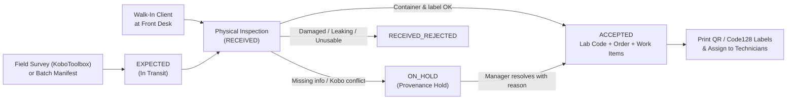

# Sample Reception, Intake, Labels & Assignment

Every soil sample that enters your laboratory starts at **Sample Reception** (`/reception`). Whether samples arrive from a field survey using KoboToolbox, in a multi-box shipment (consignment), or from a farmer walking up to the front desk, SoilFER-LIMS uses one consistent intake workflow so that no sample is lost, mislabeled, or tested before it has been physically checked.

---

## How Samples Arrive: Overview

---

## 1. Consignments & Expected Arrivals

A **consignment** is a shipment or delivery batch (for example, a cooler box or crate of 40 soil bags sent from a field campaign).

### What You See
- On the **Reception** page (`/reception`), the **Expected Arrivals** tab lists samples pre-registered from KoboToolbox or a project manifest with status `EXPECTED` and no reception date (`receptionDate` is blank).
- The **Consignments** panel shows incoming shipments, their sender, courier/waybill reference, and the **Declared Expected Count** (if the sender declared how many bags were shipped). If the sender did not declare a count, it is shown as *Not declared* rather than guessing zero.

### What You Do
1. Open **Reception** (`/reception`).
2. If logging a new shipment box, click **New Consignment**, select the project and receiving laboratory, enter the sender details, and optionally enter the **Declared Expected Count** (must be at least 1 if provided).
3. Search or scan the field bag ID in the **Expected Arrivals** list to match each physical bag in front of you against its digital record.

### What Happens Next
- Pre-registered samples stay in `EXPECTED` status until you confirm that the physical bag is in your hands.
- Samples in `EXPECTED` status **cannot** be assigned to technicians, dried, or tested, and cannot print a permanent laboratory barcode label yet.

---

## 2. Walk-In & Batch Intake

When a farmer, researcher, or extension officer brings soil bags directly to the laboratory without prior KoboToolbox registration, use **Walk-In Intake** or **Batch Intake**.

### What You See
- The **New Sample / Walk-In Intake** form asks for the project (or walk-in client details), field sample ID, collection date, sampling depth (top and bottom cm), optional soil profile reference, physical condition checklist, received mass (in grams, `g`), and the requested soil analyses or analysis package.

### What You Do
1. Click **Walk-In Intake** (for one sample) or **Batch Intake** (for a spreadsheet/list of samples).
2. Enter the sample identity and field context:
   - **Depths & Coordinates**: Enter the exact values recorded by the submitter (decimals such as `0` to `15.5 cm` are kept as entered). Leave unknown depths, GPS coordinates, or collection dates blank—never invent placeholder numbers.
   - **Soil Profile Reference (Optional)**: If the sample comes from a recorded soil pit or sampling point, select its relationship (*Confirmed profile*, *Sampling point*, *Composite area*, or *Record as unknown*). An unknown profile never blocks laboratory work.
   - **Sample Mass**: Enter the received mass in grams (`g`). Zero grams (`0 g`) is a valid observation if a bag arrived empty; if the sample was not weighed at intake, leave mass blank. Batch intake never invents default mass or moisture values.
3. Complete the **Physical Inspection Checklist** (container intact, label legible, sufficient soil volume, no cross-contamination).
4. Select the **Requested Analyses** (or choose a pre-configured package such as *Routine Fertility*).
5. Click **Receive & Accept** (or **Record Arrival** if inspection is still underway).

### What Happens Next
- **Two-Step Arrival vs. Acceptance**:
  - Recording **Physical Arrival** moves the sample to `RECEIVED` and logs an immutable `RECEIVED` custody event with your username and server timestamp, without issuing a permanent lab code or creating test jobs yet.
  - Confirming **Acceptance** moves the sample to `ACCEPTED`, atomically allocates its unique **Laboratory Sample Code**, records the initial **Order Revision**, and creates one **Work Item** for each required preparation gate and ordered analysis.

---

## 3. Laboratory Sample Codes & Check Characters

When a sample is accepted, SoilFER-LIMS automatically issues a permanent **Laboratory Sample Code** (`labSampleCode`).

- **Configurable Format per Lab**: Each laboratory configures its sample code format and counter reset rule in **Settings → Laboratory Policy** (`sample.codeFormat` and `sample.sequenceReset`).
  - The shipped default across all presets is `{LAB}-{YY}-{SEQ:6}{CHK}` with a `YEARLY` counter reset (in the laboratory's local timezone)—for example, `GTM-26-000142K`.
  - Supported format tokens are `{LAB}`, `{YY}`, `{YYYY}`, `{SEQ}` (with optional zero-padding such as `{SEQ:6}`), `{PROJECT}`, and `{CHK}`. If your lab's format includes `{PROJECT}`, every sample must belong to a project at intake.
- **Built-in Typo Protection (`{CHK}`)**: The check character at the end of the code is calculated using the **ISO 7064 MOD 37,36** standard across all letters and digits in the code. When a technician later types or scans a sample code at the bench, the system checks this final character to catch typing mistakes immediately.
- **Permanent & Never Renumbered**: Once a laboratory sample code is issued, it is permanent. Changing your lab's code format setting only affects future samples—existing samples are never renumbered.

---

## 4. Printing Sample, Container & Aliquot Labels

After a sample is accepted (and whenever sub-containers or aliquots are created), you can print durable **QR** and **Code128** barcode labels.

### What You See
- Clicking **Print Labels** opens the unified Label Print Dialog.
- You can choose between two physical label sizes:
  - **Standard (`STANDARD`)**: `101 × 54 mm` — includes full sample/container details, QR code, and Code128 linear barcode. Required for long sample codes so barcode bars stay wide enough (`≥ 0.19 mm`) for reliable scanning.
  - **Compact (`COMPACT`)**: `50 × 25 mm` — designed for small vials, tubes, and aliquot cups.
- If any selected sample or container has **already been printed before**, the dialog highlights it as a **Reprint** and requires a **Reprint Reason**.

### What You Do
1. Select one or more accepted samples (or containers/aliquots on the Sample Detail page) and click **Print Labels**.
2. Choose **Standard (101 × 54 mm)** or **Compact (50 × 25 mm)** and set the copy count (`1` to `20` copies per item, up to `200` labels per batch).
3. Click **Preview** to inspect the layout on screen. Previewing does not record a print event.
4. If any label is a reprint (for example, a label was smudged or torn during drying), type the mandatory **Reprint Reason**.
5. Click **Print**.

### What Happens Next
- SoilFER-LIMS records an immutable `LabelPrintEvent` in the database (recording the exact code, print ordinal `1, 2, ...`, copy count, format, timestamp, user, and reprint reason) **before** opening the browser's print window.
- Because the system records the print request before paper leaves the printer, if you cancel the browser print dialog or the printer jams, the next print will be tracked as a **Reprint** and will ask for a reason.
- Pre-arrival (`EXPECTED`), rejected (`RECEIVED_REJECTED`), or disposed (`DISPOSED`) samples cannot print permanent labels.

---

## 5. Provenance Holds, Rejections & Undoing Intake

Sometimes a sample arrives with a problem that must be resolved before testing can begin.

### Scenario A: Placing or Resolving a Sample Hold (`ON_HOLD`)
A sample is placed in `ON_HOLD` either manually by reception/management (for example, unreadable paperwork or missing client authorization) or automatically when a KoboToolbox re-sync detects a conflicting field change after receipt.

- **What you see**: A prominent **On Hold** badge on the sample in Reception, the Sample List, and the Sample Detail page, explaining why the hold was raised. While `ON_HOLD`, the sample cannot be assigned to technicians, prepared, tested, or exported.
- **What you do**: A **Lab Manager** opens the sample, reviews the hold details (for example, comparing original vs. updated Kobo field metadata), clicks **Resolve Hold**, and enters a mandatory **Resolution Reason**.
- **What happens next**: Once the last open hold on the sample is resolved, the sample automatically returns to its recorded prior status (such as `ACCEPTED` or `PROCESSING`) and can be assigned and tested.

### Scenario B: Rejecting an Unsuitable Sample at Intake (`RECEIVED_REJECTED`)
If a physical bag arrives broken, cross-contaminated, or with too little soil to test:

- **What you see**: The **Reject Sample** option during reception inspection.
- **What you do**: Select the non-conformance reason (such as damaged container, leakage, insufficient volume, or missing identity) and confirm rejection.
- **What happens next**: The sample moves to `RECEIVED_REJECTED`. Any unstarted work items are marked cancelled (`INTAKE_REJECTED`) while keeping their full audit history. Rejected material can then be safely disposed of with a recorded reason.

### Scenario C: Undoing an Accidental Intake (`INTAKE_UNDONE`)
If a sample was accepted by mistake (for example, the wrong expected row was clicked) **before any laboratory work has started**:

- **What you see**: The **Undo Intake** button on an `ACCEPTED` sample that has no recorded preparation, drafts, attempts, results, spectral scans, equipment/inventory usage, or QC batch links.
- **What you do**: Click **Undo Intake** and provide a mandatory reason.
- **What happens next**: The sample returns to its pre-acceptance state and its unstarted work items are marked `CANCELLED` (`INTAKE_UNDONE`). If the sample is later re-accepted, the system reuses those cancelled work items for matching analyses and preserves the full audit trail. If any analytical or preparation work has already been recorded, the system refuses Undo Intake to protect laboratory records.

---

## 6. Assigning Samples & Updating Ordered Analyses

Once a sample is `ACCEPTED` (and not `ON_HOLD`), the **Lab Manager** assigns work items to bench technicians and can revise the ordered tests if the client or project changes its request before approval.

### Assigning Work Items to Technicians
- **What you see**: On the **Samples** page or **Sample Detail** page, each sample's required preparation gates (`DRYING`, `PREPARATION`) and analytical tests (`pH`, `SOC`, `P`, `TEXTURE`, etc.) appear as **Work Items** with status `NOT_ASSIGNED` or `ASSIGNED`.
- **What you do**: Select the work items (or a group of samples), choose the target **Lab Technician** from your laboratory roster, and click **Assign**.
- **What happens next**: The work items move to `ASSIGNED` (or update their assigned analyst) and appear immediately in that technician's **Workbench** queue. Samples that are `ON_HOLD`, `EXPECTED`, or closed cannot be assigned.

### Updating Ordered Analyses (Order Revisions)
If you need to add or remove a soil test on an active sample before the sample is approved:

- **What you see**: The **Edit Analyses / Order Revision** dialog on the Sample Detail page, showing the currently active ordered analyses.
- **What you do**: Check or uncheck the target analyses, enter a mandatory **Reason for Order Revision** (for example, *"Client requested Electrical Conductivity in addition to Routine Fertility"*), and click **Save Order Revision**.
- **What happens next**:
  - SoilFER-LIMS supersedes the previous active order revision, creates a new active `OrderRevision` linked to each `WorkItem`, adds any newly requested work items, and safely cancels/removes unstarted work items that were dropped.
  - If an analysis already has recorded attempts, results, or batch membership, it cannot be silently deleted.
  - Once a sample is `APPROVED`, `ARCHIVED`, or `DISPOSED`, you cannot edit its order directly—post-approval changes must go through the formal **Amendment Workflow** (see [Certificate of Analysis & PDF Reports](./reporting-pdf.md)).
