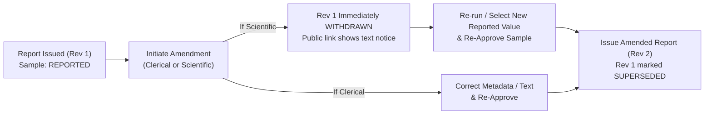

# Certificates of Analysis, PDF Reports & Amendments

Once a sample has been reviewed and approved (`APPROVED`), SoilFER LIMS can issue an official **Certificate of Analysis (COA)** as a vector PDF document, share it via a verifiable QR code or public link, and—if an error is ever discovered after release—manage formal **Post-Report Amendments and Report Revisions** in compliance with ISO/IEC 17025 §7.8.8.

---

## 1. Issuing a Certificate of Analysis (PDF)

### What You See

When viewing an `APPROVED` sample (or selecting multiple approved samples in a consignment), the **Reports** panel shows:
- Whether a report has already been issued (`ISSUED`, `SUPERSEDED`, or `WITHDRAWN`)
- The **Language** selector (`en`, `fr`, `pt`, `es`, `es-419`)
- The **Moisture Basis** selector (`AIR_DRY` default, or `OVEN_DRY` when moisture content was measured and parameters are marked `report.ovenDryConvertible`)
- Options to **Generate / Issue Report**, **Download PDF**, or **Manage Public Link**

### What You Do

1. Open the approved sample and click **Issue Certificate of Analysis** (or select multiple approved samples in the Consignment view and click **Batch Issue Reports**).
2. Choose the report language and moisture basis if applicable.
3. Click **Issue Report**.

### What Happens Next

- The LIMS assigns a unique, sequential **Report Number** (formatted per `report.numberFormat`, such as `RPT-NRL-2026-00042`, **Revision 1**).
- The sample status advances from `APPROVED` to **`REPORTED`**, and its archive retention countdown (`sample.retentionDaysAfterReport`) begins.
- A frozen snapshot of all reported values, units, methods, preparation records, caveats, and approver signatures is stored with the report revision so historical PDFs never drift if master data changes later.

---

## 2. What Appears on the Certificate of Analysis

Every generated PDF is rendered server-side and contains only verified facts recorded for that specific sample (aligned with ISO/IEC 17025 §7.8):

1. **Header, Report Number & Revision Badge**:
   - Laboratory name, address, logo, and accreditation/programme identifiers.
   - Unique **Report Number** (`RPT-...`) and **Revision Number** (`Rev 1`, `Rev 2`, etc.).
   - If the report is a revision (`Rev 2+`), a prominent **Amended Report Banner** at the top of page 1 stating which report and revision it replaces and why.
2. **Sample Provenance & Chain of Custody**:
   - Laboratory Sample Code, Client/Field Sample ID, Consignment Number, Submitter, and Project Name.
   - Sampling Date, Depth Layer, GPS Coordinates (when provided), Reception Date, Condition on Arrival, Analysis Date, and Report Issue Date.
3. **Actual Pre-Analytical Drying & Preparation Record**:
   - Displays the actual recorded drying temperature ($^\circ\text{C}$), duration, sieve mesh size ($\text{mm}$), and preparation completion date—never a generic boilerplate claim if a step was bypassed or modified.
4. **Moisture Basis Statement**:
   - Explicitly states whether results are reported on an **Air-Dry Basis (`AIR_DRY`)** or **Oven-Dry Basis (`OVEN_DRY`, $105^\circ\text{C}$)**, along with the measured gravimetric moisture percentage when applicable.
5. **Categorized Analytical Results Table**:
   - Grouped by analytical category (Soil Reaction & Salinity, Organic Matter & Nitrogen, Macronutrients, Exchangeable Cations & CEC, Micronutrients, Physical Properties / Texture).
   - Displays the **Saved Reported Value** from the approved `ReportedValueSelection` (never a live recalculation of raw attempts).
   - Respects your lab's `results.betweenLodLoq` setting (printing `< LOQ` when set to `REPORT_LT_LOQ`, or the numeric value with a `J` qualifier flag when set to `REPORT_VALUE_FLAGGED`).
   - Optionally prints **Expanded Measurement Uncertainty ($U$)** and coverage factor $k$ when `report.uncertaintyMode` is enabled (`EXPANDED_ABSOLUTE` or `EXPANDED_RELATIVE_PCT`).
   - Shows the Standardized Unit, Analytical Method Reference (e.g., *ISO 10390*, *Olsen P*, *Walkley-Black*), and—when enabled for the profile—the 5-tier Agronomic Interpretation badge.
6. **Soil Diagnostics & Cross-Check Summary**:
   - Derived USDA Textural Class (from Sand/Silt/Clay) and $\text{C:N}$ ratio assessment where applicable.
7. **Truthful Quality Control & Caveat Disclosures**:
   - Summarizes the actual batch QC verification status for the methods included on the certificate.
   - Lists any **Reception Deviations**, **Preparation Caveats**, or **QC Caveats** that were formally accepted during review so the client has full transparency.
8. **Electronic Authorization & QR Verification**:
   - Prints the name, role, and timestamp of the Technical Reviewer and Final Approver, plus a scannable **QR Code** linking to the public verification endpoint.

---

## 3. Public Sharing, QR Verification & Link Revocation

You can share reports with farmers, extension officers, or institutional clients without giving them a LIMS login:

- **Authenticated Download**: Staff logged into the LIMS can download any report via the **Download PDF** button (`GET /api/reports/:reportId/pdf` or `GET /api/reports/sample/:sampleId/pdf`).
- **Public Verification Link & QR Code**: When a public share token is active (`GET /api/reports/public/:token/pdf`), scanning the QR code on a printed certificate or opening the share URL downloads the authentic PDF directly from the LIMS.
- **Revoking or Expiring a Link**: A Lab Manager or Administrator can revoke a public link at any time from the sample's **Reports** tab. Once revoked or expired, the URL returns `HTTP 410 Gone` and no longer serves the PDF.

---

## 4. Post-Report Amendments & Report Revisions

Once a Certificate of Analysis is issued (`REPORTED`), its results are locked. If you later discover a typo in client metadata or need to correct an analytical result after the report was already issued, SoilFER LIMS provides a structured **Sample Amendment** and **Report Revision** workflow (ISO/IEC 17025 §7.8.8).

### Step 1: Initiating a Sample Amendment

#### What You See

On a `REPORTED` sample, the **Amend Sample / Correct Report** button opens the Amendment dialog, which asks you to classify the amendment:

- **Clerical Amendment (`CLERICAL`)**: Correcting non-analytical metadata (such as a misspelled client name, project code, or field label) without changing any analytical test values or interpretations.
- **Scientific / Analytical Amendment (`SCIENTIFIC`)**: Re-opening one or more analytical results, preparation records, or QC decisions to re-test or select a different reported value.

#### What You Do

1. Click **Amend Sample / Correct Report**.
2. Choose **`CLERICAL`** or **`SCIENTIFIC`**, select which parameters (if scientific) are affected, and enter a mandatory **Reason for Amendment**.
3. If your lab policy has **`report.amendmentRequiresSecondPerson = true`** (enabled in `ISO17025_STRICT` and `BASIC` presets), a second authorized Reviewer or Lab Manager must approve the amendment request before a scientific amendment unlocks the sample.

#### What Happens Next

- **Immediate Withdrawal of Unsafe Reports**: As soon as a scientific amendment is opened on a sample with an issued report, the existing report (`Rev 1`) is immediately marked **`WITHDRAWN`** so nobody can accidentally rely on an unverified certificate while re-testing is underway.
- **Public Link Protection**: If an external user scans the QR code or visits the public link of a `WITHDRAWN` or `SUPERSEDED` report, the LIMS **does not serve the outdated PDF**; instead, it displays a plain-text notice stating that the report has been withdrawn/superseded and directing the reader to contact the laboratory for the current revision.

### Step 2: Issuing the Amended Report (`Rev 2+`)

Once the correction or re-analysis is complete and the sample has been re-approved (`APPROVED`):

1. Open the **Reports** tab on the sample and click **Issue Amended Report**.
2. Confirm the **Amendment Reason** that will be printed on the new certificate.
3. Click **Issue Revision**.

#### How the Amended PDF Looks

- The new certificate is issued with an incremented revision number (**`Revision 2`**, **`Revision 3`**, etc.) and references the previous report.
- The previous report transitions to **`SUPERSEDED`** and remains permanently linked in the revision history table.
- A prominent **Amended Report Statement** appears on the certificate:
  > *"Amended report — replaces RPT-NRL-2026-00042 revision 1; reason: Re-analysis of Olsen P following dilution check."*
  *(Administrators can customize this phrasing across all 5 languages via the `report.amendedStatement` lab setting using `{replacedNumber}`, `{replacedRevision}`, and `{reason}` placeholders.)*
- In the Analytical Results Table:
  - Results that **changed** since the previous revision are marked with a dagger (**`†`**)
  - Results that were **newly added** are marked with a double dagger (**`‡`**)
  - Any parameters that were **removed** are listed in a footnote beneath the table so the reader can see every difference between revisions at a glance.

---

## 5. Exporting Results (CSV, Excel & Data Exchange)

When you export sample results from the LIMS—whether via **CSV**, **Excel (`.xlsx`)**, or the **v1 Data Exchange / NSIS** endpoints—the export always outputs the **saved Reported Value** from the approved `ReportedValueSelection` record along with its unit, method code, censoring qualifier (`< LOD`, `< LOQ`, `J`), and report revision reference.

> [!NOTE]
> For research pipelines and national soil information systems that also require the full underlying history of individual analytical attempts, replicates, and batch links, the **Data Exchange API v2 (`/api/v2/data-exchange/observations`, alias `/api/v2/sis/observations`)** provides lossless access to every raw attempt alongside the `reportedValueSelectionId` that identifies which value was officially reported.
