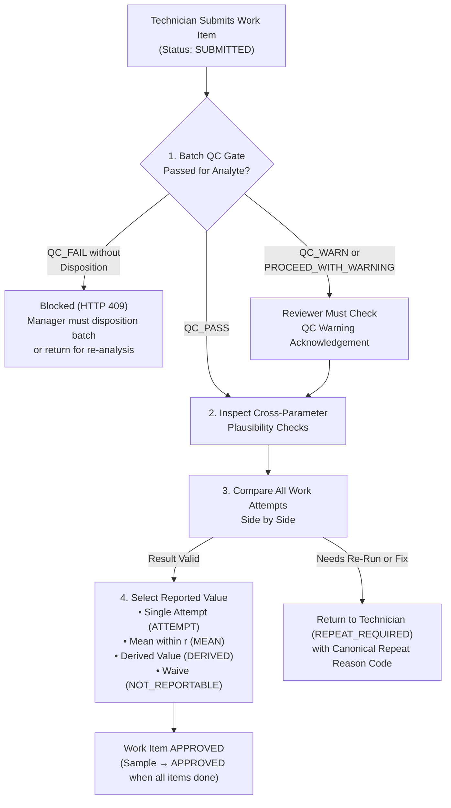

# Review, Approval, Repeats & Reported Value Selection

In SoilFER-LIMS, bench technicians record and submit analytical results, while a **Lab Manager** (or authorized reviewer with `APPROVE_RESULTS`) reviews the quality evidence, selects the official **Reported Value** across attempts, and approves or returns the work.

---

## Visual Overview: The Review & Selection Gate

---

## 1. Opening the Manager Review Queue

### What You See
When you open the **Manager Review Queue** (`/manager-queue`) or a sample's review panel:
- Only work items currently in **`SUBMITTED`** status can be reviewed (preventing race conditions or reviewing unfinished drafts).
- **Two-Person Review Rule (`review.secondPersonRequired`)**: Under the `ISO17025_STRICT` and `BASIC` presets (configurable per laboratory), the person who approves a result must be different from the technician who recorded it.
- Each submitted item displays:
  1. Its **Analytical Batch & QC Verdict** (`QC_PASS`, `QC_WARN`, or `QC_FAIL` / disposition status),
  2. Every **Work Attempt** (`attemptNo = 1, 2, ...`) recorded for that test, side by side,
  3. Any **Cross-Parameter Plausibility Flags** for the sample, and
  4. Any **Pending Value Override Requests** submitted by the technician.

---

## 2. Checking the Batch QC Gate & Acknowledgements

Before a work item can be approved, SoilFER-LIMS checks the QC verdict of the batch and analyte in which it was measured:

- **If the batch analyte is `QC_PASS`**: You can proceed directly to reviewing the result.
- **If the batch analyte is `QC_FAIL` (in Blocking Mode)**: Approval is blocked (`HTTP 409`). You must first go to **Quality Control** and disposition the batch (for example, `REANALYZE_BATCH` to send the samples to a new batch, or `PROCEED_WITH_WARNING` with a documented scientific justification).
- **If the batch analyte has a QC Warning (`QC_WARN`) or a `PROCEED_WITH_WARNING` Disposition**:
  - **What you see**: An amber **QC Acknowledgement Required** box showing the warning or manager disposition reason.
  - **What you do**: Check the **Acknowledge QC Warning** confirmation box (`QC_ACKNOWLEDGEMENT_REQUIRED`) when approving the result.
  - **What happens next**: Your acknowledgement is recorded in the audit trail, and the QC caveat is frozen into the sample's final Certificate of Analysis.

---

## 3. Cross-Parameter Plausibility Checks (Review Aid)

Soil Properties in the same sample are chemically and physically related. Whenever a sample is submitted—and again as you select reported values during review—SoilFER-LIMS runs **advisory cross-parameter checks** (`CrossCheckEvaluation`) using your laboratory's configurable thresholds (`crossCheck.*` in **Settings → Laboratory Policy**):

| Check | What It Compares | Shipped Default Threshold (Configurable per Lab) | What Flag Means |
| :--- | :--- | :--- | :--- |
| **Sum of Bases vs. CEC** | $\text{Ca} + \text{Mg} + \text{K} + \text{Na}$ vs. $\text{CEC}$ (in $\text{cmol(+)/kg}$) | `crossCheck.basesCecFactor = 1.1` ($\sum\text{Bases} \le 1.1 \times \text{CEC}$) | Flags when exchangeable bases exceed CEC by more than $10\%$ (common in calcareous or saline soils, or indicates an extraction/dilution error). |
| **Base Saturation %** | $\frac{\sum\text{Bases}}{\text{CEC}} \times 100\%$ | `crossCheck.baseSaturationMaxPct = 100%` | Flags when calculated base saturation exceeds the configured percentage. |
| **Texture Closure** | $\text{Sand \%} + \text{Silt \%} + \text{Clay \%}$ | `crossCheck.textureClosureTolerancePct = 2%` ($100\% \pm 2\%$) | Flags if the three particle-size fractions do not sum to $100\% \pm 2\%$. |
| **C:N Ratio** | $\text{Organic Carbon} \div \text{Total Nitrogen}$ (on matching moisture basis) | `crossCheck.cnMin = 8`, `crossCheck.cnMax = 25` | Flags unusually low ($< 8$) or high ($> 25$) C:N ratios so you can verify neither carbon nor nitrogen had a decimal or dilution error. |
| **Carbonates vs. Soil pH** | Measurable carbonate ($\text{CaCO}_3$) vs. $\text{pH}$ | `crossCheck.carbonatePhMin = 7.0` | Flags if significant free carbonates are reported on an acidic soil ($\text{pH} < 7.0$). |

> [!NOTE]
> Cross-parameter checks are **review aids**: they highlight potential analytical inconsistencies so you can request a `CONFIRMATION` or `REVIEW_OUTLIER` repeat when needed, without silently altering any measurement.

---

## 4. Selecting the Official Reported Value Across Attempts

When a test has been measured more than once (multiple **Work Attempts**) or has multiple replicates, SoilFER-LIMS **never guesses** which number to report using a hidden "latest row wins" rule. Instead, the reviewer makes an explicit, audited **Reported Value Selection (`ReportedValueSelection`)**.

### What You See
- A side-by-side comparison table showing every attempt (`Attempt #1`, `Attempt #2`, ...), its replicate readings, analytical batch, QC status, instrument, analyst, date, and repeat reason.
- Your laboratory's default guidance rule (`results.reportedValueRule` in **Settings → Laboratory Policy**: `MEAN_IF_WITHIN_R` in `Strict`/`Basic`, `LATEST_VALID` in `Advisory`, or `REVIEWER_PICKS`).

### Your Selection Modes
1. **Select a Specific Attempt (`ATTEMPT`)**:
   - Choose one specific valid attempt (for example, selecting `Attempt #2` after `Attempt #1` was invalidated by a batch failure or dilution).
   - If you explicitly select an attempt that was previously marked `QUESTIONED` (for example, after a `REVIEW_OUTLIER` check proved the original reading was actually right), you must enter a **mandatory reason** explaining your choice.
2. **Report the Mean of Agreeing Attempts (`MEAN`)**:
   - When two or more valid attempts (or duplicate replicates) agree within the method's configured **Repeatability Limit ($r$, `qc.repeatabilityLimit`)**, you can select **Report Mean** (`mode: 'MEAN'` with the chosen attempt IDs).
   - SoilFER-LIMS verifies that all chosen attempts share the exact same controlled unit and method, are uncensored (not `< LOQ`), and have a spread $\le r$. The system saves the full-precision arithmetic mean and rounds it to the method's configured `decimalPlaces` when rendering the PDF report.
3. **Derived Value (`DERIVED`)**:
   - Used for parameters calculated from other approved selections on the sample (such as USDA Soil Texture derived from Sand, Silt, and Clay).
4. **Mark Not Reportable / Waive (`NOT_REPORTABLE`)**:
   - If a test cannot produce a valid reportable result (for example, sample matrix interference or insufficient remaining soil for a repeat), select **Not Reportable (`NOT_REPORTABLE`)** and enter a **mandatory reason**.
   - The work item moves to `WAIVED`, and the PDF report prints your localized explanation instead of a number.

### Special Rule for Particle Size & USDA Soil Texture (`TEXTURE`)
When a sample has separate work items for `SAND`, `SILT`, `CLAY`, and `TEXTURE`:
- Approve and save the reported-value selection for **`SAND`**, **`SILT`**, and **`CLAY` first**.
- The **`TEXTURE`** selection then binds to those three saved fraction selections to derive the official USDA 12-class soil texture.
- If any fraction's reported value is later changed or repeated, SoilFER-LIMS automatically marks the `TEXTURE` selection as stale (`REPORTED_VALUE_STALE`) until `TEXTURE` is re-reviewed against the updated fractions.

---

## 5. Returning a Work Item for Rework or Repeat (`RETURN`)

If you are not satisfied with a submitted result:

### What You Do
1. In the **Manager Review Queue**, click **Return / Request Repeat** on the submitted work item.
2. Choose the mandatory **Repeat Reason Code**:
   - `REVIEW_OUTLIER` — Value is implausible or failed a cross-parameter check (marks original attempt `QUESTIONED`).
   - `CONFIRMATION` — Requesting a confirmation re-run on an unusual value (marks original attempt `QUESTIONED`).
   - `INSTRUMENT_FAULT` or `PREP_ERROR` — Equipment or preparation problem identified during review (marks original attempt `INVALIDATED`).
   - `ABOVE_RANGE_DILUTION` — Reading exceeded calibration range; requires dilution and re-run (marks original attempt `INVALIDATED`).
   - `TRANSCRIPTION_ERROR` — Typing mistake identified during review (prompts a same-attempt correction with mandatory reason).
   - `OTHER` — Requires a mandatory free-text explanation.
3. Add instructions for the technician and click **Confirm Return**.

### What Happens Next
- SoilFER-LIMS atomically moves the work item back to **`REPEAT_REQUIRED`**, clears its old `submissionId` so the technician can cleanly resubmit after rework, and reserves a new `OPEN` **Work Attempt** (`attemptNo + 1`).
- **Attempt Limit Check**: If returning the item reaches your laboratory's maximum attempt limit (`repeats.maxAttemptsBeforeNcr`, default `3` in `Strict`, `5` in `Basic`), you must use the **Manager Limit Override** action, which opens a linked **Nonconformity Report (NCR)** in the same transaction.

---

## 6. Final Sample Approval & Order Acknowledgements

- When every required work item on a sample is `APPROVED` (or `WAIVED` with a recorded reason) and has a valid saved **Reported Value Selection**, the parent sample automatically transitions to **`APPROVED`**.
- In the **Data Results** grid and project views, managers and project coordinators can track **Order / Client Acknowledgements** alongside issued certificates.
- Once a sample reaches **`APPROVED`**, all work items, attempts, and selections are sealed against ordinary edits—any later retest or change must go through the **Sample Amendment Workflow** (see [Certificate of Analysis & PDF Reports](./reporting-pdf.md)).
