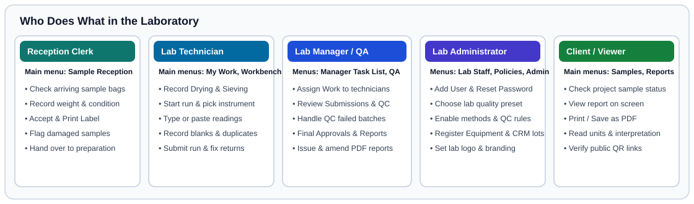

# Users, Roles & Separation of Duties

> *Time:* 10 minutes.
> *Who can do this:* Laboratory Administrators, Laboratory Managers, and Quality & Audit Officers.

SoilFER LIMS uses role-based permissions and laboratory access separation. Every person sees only the screens they need for their job. When two-person review is enabled, no single person can both enter a bench measurement and approve their own result.

---

## Which Role Should Each Person Have?

| On-Screen Role Label | Typical Person in the Lab | What They Can Do |
| :--- | :--- | :--- |
| **Sample Reception Officer** | Front-desk reception clerk | Receive walk-in and project samples in **Sample Reception**, inspect bag condition, print barcode labels, and log sample handover. Cannot enter bench measurements or approve results. |
| **Laboratory Technician** | Wet-chemistry, preparation, or spectroscopy analyst | Open **My Work** and **Workbench**, complete drying and preparation checklists, build analytical runs, enter sample and QC values, and submit runs for review. Cannot approve results or issue reports. |
| **Laboratory Manager** | Head of laboratory or senior supervisor | Assign work, inspect and decide on QC batches, review and approve submitted results in **Manager Task List**, issue and amend **Certificate of Analysis** PDFs in **Reports**, and manage local staff and **Policies**. |
| **Quality & Audit Officer** | QA Officer or internal auditor | Monitor **QA Dashboard**, control charts, proficiency testing, problem records, and **Audit & Security** logs. Can also review or co-sign results where authorized. |
| **Project Manager** | Survey or project coordinator | Coordinate project intake, manifests, KoboToolbox links, and servicing laboratories in **Projects**. Track sample progress and released reports. |
| **Read-Only Viewer** | Agronomist, client, or ministry partner | Browse released results in **Data Results** and **Country Data**. Download approved **Certificate of Analysis** PDFs in **Reports**. |
| **National Lead / Master User** | National network coordinator | Coordinate multi-laboratory programmes, national methods, and authorized regional facilities. |
| **Super Administrator** | Platform or IT administrator | Manage all laboratories, system languages, **Branding & Identity**, and **National SIS & Data Exchange** keys. |

---

## How Separation of Duties Protects Your Lab

1. *Reception is separate from testing:* A **Sample Reception Officer** registers physical arrival and prints barcode labels. Bench measurements happen only in **Workbench**.
2. *Bench entry is separate from approval:* A **Laboratory Technician** records raw readings and submits the run. Only a **Laboratory Manager** (or authorized reviewer) can click **Approve** in **Manager Task List**.
3. *Two-person review (optional per lab):* When **Require a second reviewer** is enabled in **Policies**, the person who recorded or submitted a bench result cannot approve that same result—even if they hold a **Laboratory Manager** account.
4. *Two-person report amendment (optional per lab):* When **Require a second person for amendments** is enabled in **Policies**, a second authorized person must co-sign any amendment to a released report before the new PDF revision is issued.
5. *Laboratory isolation:* Staff assigned to a facility under **Assigned Laboratory** see only their own laboratory's samples, work queue, equipment, and inventory.

---

## Step-by-Step Admin Task Guide

- [Create Staff Accounts, Assign Roles, and Reset Passwords](../admin/manage-users-and-roles.md) — invite new staff with a **One-Time Activation Link**, change someone's role or assigned laboratory, issue a password recovery link, or suspend an account.

---

### For the QA Person

- *Authorization records:* Every invitation, role assignment, laboratory assignment change, suspension, and password recovery action is recorded with the administrator's username, timestamp, and reason in **Audit & Security**.
- *Safe role transitions:* Clicking **Review Access** on an existing staff member opens **Pre-Change Access Review**. This screen shows **Unfinished Sample Determinations** and **Active Sessions Invalidation** before you apply the change.
