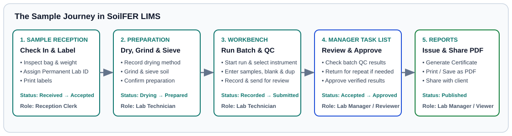

# The Sample Journey (End-to-End)

> *Time:* 5 minutes
> *Who can do this:* Reception clerks, laboratory technicians, laboratory managers, QA officers, and project coordinators

This page shows how a soil sample travels through SoilFER LIMS. It covers the full path from field collection or reception until the official **Certificate of Analysis** PDF is issued and the bag is archived or disposed of.

---

## Stage 1: Field Collection & Sample Reception

Samples can enter your laboratory in three ways:
1. *Field mobile surveys:* Field teams send mobile forms from KoboToolbox with GPS coordinates, sampling depth, soil profile code, and bag photos. New survey rows appear in **Sample Reception** as **Expected** (**Awaiting arrival**) until the physical bag arrives.
2. *Boxes and sample deliveries:* Shipments arrive with a manifest spreadsheet and an optional declared box count.
3. *Walk-in clients:* Farmers, researchers, or extension officers bring soil bags directly to the counter.

At **Sample Reception**:
- Inspect each bag. Make sure the label is readable, the container is intact, and there is enough soil.
- Record physical arrival (status becomes **Received**) and click **Accept Sample** (status becomes **Accepted**). If paperwork needs checking, place the bag **On Hold**. If the bag is damaged or leaking, mark it **Rejected (Non-Conformance)** (refused with a problem record).
- Click **Print labels** to print **Standard (101 × 54 mm)** or **Compact (50 × 25 mm)** barcode labels carrying the permanent laboratory sample code.

👉 *Step-by-step guides:* [Reception: Receiving Samples & Labels](./reception-and-intake.md) and [KoboToolbox Field Integration](./kobotoolbox.md).

---

## Stage 2: Drying, Preparation & Sub-Sampling

Before chemical or spectral measurements begin, the sample must pass your laboratory's drying and preparation steps:
- In **My Work** or **Workbench**, complete the drying record (air-drying or oven temperature, start and end times, and optional oven asset) and click **Confirm Complete**.
- Complete the preparation record for sieving (including mass before sieving and coarse stones mass in grams), grinding, or splitting. You can also create sub-sample containers and print container labels.
- Once preparation is complete, the sample status moves from **Accepted** to **Processing**, unlocking its bench tests.

👉 *Step-by-step guide:* [Preparation: Drying, Grinding, Storage & Custody](./preparation-and-custody.md).

---

## Stage 3: Bench Analysis & Quality Control Runs

Technicians perform tests inside an analytical batch in **Workbench**:
- Select your test method and an **In Service**, **Ready / Calibrated** instrument.
- Scan sample barcodes into the batch grid (or print a bench worksheet). Enter raw readings or import an instrument file alongside your batch **Blank**, **Duplicate**, and **Control** (**Laboratory reference material (LRM)** (your lab's own in-house check soil) or **Certified reference material (CRM)** (official standard soil with a certified value)) slots.
- If a typing error or instrument fault happens before you send the batch, record a pre-submission repeat or correction with a short reason.
- Submit the completed batch for review. SoilFER LIMS checks your laboratory's QC rules and sends the results to **Manager Task List**.

👉 *Step-by-step guides:* [Technician: Workbench & Analytical Runs](./technician-workbench.md) and [Quality Control, Control Charts & Failed QC](./qc-management.md).

---

## Stage 4: Manager Review, Repeats & Approval

Technicians record and submit measurements. Only a **Laboratory Manager** (or authorized reviewer) can approve them:
- Open **Manager Task List** to inspect the batch QC verdict, cross-parameter plausibility checks, and all numbered measurement tries.
- If a test was run more than once or has replicates, choose the final report number (**Report attempt** (use this measurement try on the report), **Report mean**, **Report class from selected fractions**, or **Not reportable** with a reason).
- Click **Approve** on valid results, or return a questionable result for repeat testing with a clear reason note.
- When every required test on the sample is approved (or waived with a reason), the sample status becomes **Approved**.

👉 *Step-by-step guide:* [Lab Manager & QA: Review, Approval & Plausibility Checks](./review-and-approval.md).

---

## Stage 5: Reporting, Amendments, Data Exchange & Retention

Once a sample is **Approved**, its results are locked against direct edits and ready for release:
- Open **Reports** (**Result Reports**) to preview and issue an official **Certificate of Analysis** PDF. It includes your laboratory's logo, preparation summary, moisture basis, QC statement, agronomic interpretation, and QR verification link.
- If a mistake is discovered after a report is issued, a manager opens a formal report amendment. This creates a new revision and retires the old public share link.
- Approved results can be exported to Excel or CSV or shared through **National SIS & Data Exchange**.
- Publishing the report starts the sample's archive retention countdown (**Sample retention after report** in **Policies**). After the retention date passes, bags past their storage date can be archived (**Archived**) or safely discarded (**Disposed**).

👉 *Step-by-step guide:* [Lab Manager & QA: Certificates of Analysis, PDF Reports & Amendments](./reporting-pdf.md).

---

## Sample Status Summary

| On-Screen Status Badge | What It Means | Who Acts Next |
| :--- | :--- | :--- |
| **Expected** | Pre-registered from KoboToolbox or a manifest spreadsheet. The physical bag has not arrived at the counter yet. | **Sample Reception Officer**: Verify physical arrival when the box arrives. |
| **Received** | Physical arrival logged at reception; bag condition inspection is underway. | **Sample Reception Officer**: Complete intake inspection and accept or reject. |
| **Accepted** | Intake accepted, permanent laboratory sample code issued, and preparation and test tasks created. | **Laboratory Technician**: Complete drying and preparation steps. |
| **On Hold** | Temporarily paused due to a paperwork question, Kobo field update, or manager hold. | **Laboratory Manager**: Review and resolve the hold with a written reason. |
| **Processing** | Drying and preparation are finished; bench testing is underway. | **Laboratory Technician**: Run tests in **Workbench** and submit for review. |
| **Partial** | Some (but not all) assigned tests have been submitted for review. | **Laboratory Technician** (remaining tests) and **Laboratory Manager** (review). |
| **Submitted** | All assigned tests are submitted and waiting for review. | **Laboratory Manager**: Check QC, choose final report numbers, and approve. |
| **Approved** | All required tests are approved (or marked **Not reportable** with a reason). Results are locked. | **Laboratory Manager**: Issue the **Certificate of Analysis** PDF in **Reports**. |
| **Rejected (Non-Conformance)** | Sample was rejected at reception due to damage, leakage, or insufficient soil. | **Laboratory Manager** or **Sample Reception Officer**: Record disposal when ready. |
| **Archived** | Sample is stored in long-term archive storage after reporting. | Kept in archive storage until retention expires. |
| **Disposed** | Physical soil bag has been safely discarded after its retention period expired; all digital records remain. | Complete. |

---

### For the QA Person

- *Full log of who handled the sample and where:* Every transition in the table above—along with every physical move (**Moved**, **Issued**, **Returned**, **Sent out**)—is permanently recorded with user identity and timestamp.
- *Full status dictionary:* For every sample, work item, QC, and equipment badge in one place, see [Statuses A to Z](../reference/statuses-a-to-z.md).
