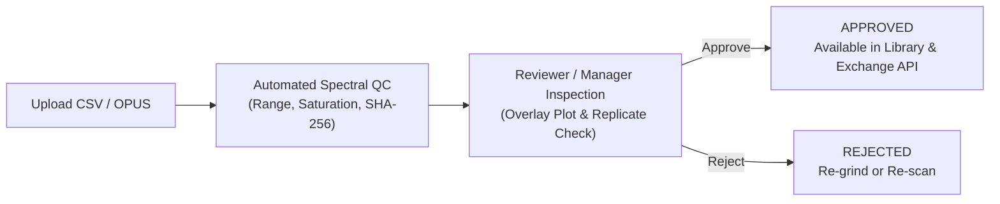

# Spectral Data Management (MIR & Vis-NIR)

For laboratories that perform infrared soil spectroscopy—**Mid-Infrared (`MIR`, $4000\text{--}400\text{ cm}^{-1}$)** or **Visible–Near-Infrared (`NIR` / `Vis-NIR`, $350\text{--}2500\text{ nm}$)**—SoilFER LIMS provides a dedicated **Spectral Library & Workbench** module for uploading, validating, reviewing, and exchanging calibrated spectral signatures alongside wet-chemistry reference results.

> [!TIP]
> **GLOSOLAN Spectroscopy Resources**: See the [FAO GLOSOLAN Soil Spectroscopy Portal](https://www.fao.org/global-soil-partnership/glosolan/soil-analysis/soil-spectroscopy) for standard operating procedures on fine grinding, background reference checks, and chemometric calibration.

---

## 1. What Soil Spectroscopy Does in the LIMS

Instead of replacing reference wet chemistry, soil spectroscopy in SoilFER LIMS works hand-in-hand with your analytical benches:

1. **Spectral Library Building**: Pair high-quality MIR or Vis-NIR scans with approved wet-chemistry reference measurements (`MEASURED`) on the same physical soil sample (`SOC`, `TN`, `pH`, `Clay`, `CEC`, etc.).
2. **Rapid Screening & Replicate Checks**: Record multiple sub-sample scans (`replicateNo: 1, 2, ...`) and automatically check spectral quality before approval.
3. **Standardized Exchange**: Export approved spectra and paired reference chemistry through the **Spectral Exchange API** (`/api/v1/data-exchange/spectra` and `/api/v2/data-exchange/spectra`) for national and global spectral calibration models.

---

## 2. Preparing Samples for Spectroscopy

Before scanning a soil sample, its physical preparation must be recorded accurately because particle size and moisture strongly affect infrared absorption:

| Preparation Code | Description | Typical Modality |
| :--- | :--- | :--- |
| **`AIR_DRY_2MM`** | Air-dried ($< 40^\circ\text{C}$) and sieved to $< 2\text{ mm}$ | Standard **Vis-NIR** ($350\text{--}2500\text{ nm}$) |
| **`AGATE_100UM`** | Sub-sampled from the $2\text{ mm}$ archive and finely ball-milled / ground in agate to $< 100\ \mu\text{m}$ | Standard **MIR** ($4000\text{--}400\text{ cm}^{-1}$) |
| **`KBR_PELLET`** | Finely ground soil diluted in potassium bromide ($\text{KBr}$) pressed pellet | Transmission **MIR** |
| **`INTACT_CORE`** | Unprocessed aggregate or intact core | Specialized field/core **Vis-NIR** |

---

## 3. Uploading & Recording Spectra

### What You See

In **Spectral Library → Upload Spectra** (or from the **Spectra** tab on a sample or bench work item), you see:
- **File Upload Dropzone** accepting:
  - **CSV matrices** (wavelengths or wavenumbers in columns, sample scans in rows)
  - **Bruker OPUS files** (`.0`, `.1`, etc. native binary spectrometer output)
- **Acquisition & Instrument Metadata** fields:
  - **Spectrometer Instrument** (linked to Equipment Inventory, e.g., *Bruker ALPHA II*)
  - **Modality & Axis Unit**: `MIR` (`WAVENUMBER_CM1`, descending $4000 \to 400\text{ cm}^{-1}$) or `NIR` (`WAVELENGTH_NM`, ascending $350 \to 2500\text{ nm}$)
  - **Signal Quantity**: `ABSORBANCE` ($\text{AU}$), `REFLECTANCE` ($R \in [0, 1]$), `TRANSMITTANCE` ($T \in [0, 1]$), or `REMANENCE` (Kubelka–Munk)
  - **Accessory & Window Material** (e.g., `DRIFT`, `ATR`, `KBR`, `ZNSE`, `QUARTZ`)
  - **Resolution & Co-Added Scans** (e.g., $4\text{ cm}^{-1}$, 32 or 64 scans)
  - **Background Reference** (e.g., `GOLD`, `SPECTRALON`, `KBR`) and background timestamp
  - **Sample Preparation & Moisture State** (`AGATE_100UM`, `AIR_DRY_2MM`; `AIR_DRY`, `OVEN_DRY`)

### What You Do

1. Select the **Spectrometer Instrument** and verify that its readiness badge is green (`READY`).
2. Confirm the **Preparation**, **Modality**, and **Background Reference** settings.
3. Drag and drop your **CSV** or **OPUS** file(s) into the upload box.
4. Match each parsed scan to its **Laboratory Sample Code** (or sub-sample container barcode) and confirm the replicate number (`replicateNo: 1, 2, ...`).
5. Click **Upload & Validate Spectra**.

### What Happens Next

For every uploaded spectrum, the LIMS automatically computes a cryptographic **`sha256` fingerprint** (preventing duplicate uploads of the exact same scan file) and runs automated spectral QC checks:
- **Axis & Range Check**: Confirms that wavenumbers/wavelengths cover the expected spectral region without missing channels or NaN values.
- **Signal Bounds Check**: Flags negative reflectance, saturated absorbance ($> 3.5\text{ AU}$), or reflectance $> 1.2$.
- **Atmospheric / Baseline Flags**: Highlights abnormal water vapor or $\text{CO}_2$ band interference or severe baseline drift.
- Validated scans enter the review queue with a **`PASS`**, **`WARN`**, or **`FAIL`** QC status badge.

---

## 4. Reviewing & Approving Spectral Scans

### What You See

In **Spectral Library → Review Queue**, Reviewers and Lab Managers can plot single or multiple replicate scans on an interactive spectral curve viewer, inspect the acquisition metadata and QC flags, and view any paired wet-chemistry results on the same sample.

### What You Do

1. Inspect the absorbance or reflectance curve (especially the quartz/silicate bands, carbonate peak near $2515 / 1430\text{ cm}^{-1}$, and organic matter C–H / C=O regions).
2. If replicate scans (`replicateNo: 1, 2`) were recorded, verify that the curves overlay closely without baseline shifts caused by poor cup packing.
3. Click **Approve Spectrum** to publish the scan into the laboratory's approved Spectral Library, or **Reject Spectrum** with a note instructing the technician to re-pack or re-grind the sample.
