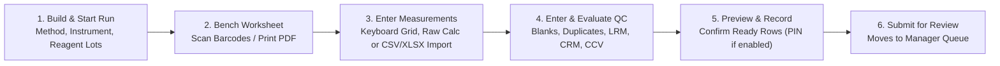

# Technician Workbench & Analytical Runs

The **Technician Workbench** (`/workbench`) is where bench analysts organize their daily analytical runs, print bench worksheets, enter measurements or import instrument files, record quality control (QC) positions, and submit completed work for manager review.

---

## Visual Overview: The Run-First Workflow

---

## 1. Building & Starting an Analytical Run

SoilFER-LIMS uses a **run-first workflow**: instead of entering isolated numbers one sample at a time, you group a batch of samples into an **Analytical Run (Batch)** that shares one analytical method, one calibrated instrument, and one set of QC positions.

### What You See
- When you open **Workbench** (`/workbench`), you see the **Run Selector** with two views:
  - **My Runs**: Shows runs assigned to you, plus your own unstarted `OPEN` runs.
  - **All Runs**: Shows all runs in your laboratory scope.
- Above the worksheet grid is the **Run Header**, displaying the run code, analytical method (and its frozen method revision once started), selected instrument, analyst, linked reagent lots, and run status.

### What You Do
1. Click **New Run** (or select an existing `OPEN` run).
2. Choose the **Analytical Method** (your laboratory's default method for that analysis is pre-selected, or you can pick another active method).
3. Select an **Eligible Instrument**:
   - The picker lists only instruments that are **In Service (`IN_SERVICE`)** in your laboratory, mapped to the method, and within their valid calibration/qualification window.
4. Select the **Samples / Work Items** to include in the run:
   - Only samples that have completed their required **Drying** and **Preparation** gates and have no active **Sample Hold (`ON_HOLD`)** can be added.
   - The system enforces your laboratory's configured **Maximum Samples per Batch** (`maxBatchSize` in **Settings → Laboratory Policy**; default `20` in `ISO17025_STRICT`, `40` in `BASIC`, or unlimited in `ADVISORY`).
5. **Link Reagent Lots (Optional)**:
   - Click **Link Reagent Lot** to attach one or more available, unexpired reagent or standard lots (`AVAILABLE` in your laboratory's inventory) to the run.
   - While a run is still `OPEN`, you can withdraw a mistakenly linked lot; once the run is started, linked lots are permanently preserved in the run's evidence (and you can still link additional lots while the run is active). Linking a lot records traceability without deducting stock quantities.
6. Click **Start Run**.

### What Happens Next
- Starting the run freezes the **Method Revision** (SOP name, standard, and version) and **Instrument** in the run header, generates the required **QC Positions** (such as Method Blanks, Analytical Duplicates, Laboratory Reference Materials, CRMs, or ICV/CCV/CCB checks according to your lab's policy), and opens the worksheet grid for data entry.

---

## 2. Bench Density & Printable Run Worksheets

When working at the wet-chemistry bench wearing gloves or away from a computer screen, two tools make recording easier:

### Glove-Friendly Bench Density
- **What you see**: A **Bench Density** toggle in the Workbench toolbar.
- **What you do**: Turn on **Bench Density** when using a touch screen or working with gloves.
- **What happens next**: Controls expand to glove-friendly touch targets, all entry text and badges render at high legibility (`≥ 14 px`), and your preference is saved for your next session.

### Printable Paper Run Worksheet (PDF)
- **What you see**: A **Download Worksheet PDF** button in the Run Header of any started run.
- **What you do**: Click **Download Worksheet PDF** (if the run covers multiple analytes, select the analyte you want to print).
- **What happens next**:
  - SoilFER-LIMS generates an A4 PDF worksheet listing every sample and QC position in exact run sequence, with **Code128 barcodes** for each sample's issued laboratory code, blank columns for raw bench readings (matching your active calculation template, such as tare mass, sample mass, or titration volume), and signature lines for the analyst and reviewer.

---

## 3. Barcode Scanning at the Bench

You can use any USB or Bluetooth **keyboard-wedge barcode scanner** to jump directly to a sample row in your run.

### What You See
- A dedicated **Scan Barcode** field in the worksheet toolbar (shortcut: press **`F2`** at any time).

### What You Do
1. Point your barcode scanner at the QR code or Code128 barcode on the sample bag or aliquot vial and pull the trigger (even if your cursor is not currently inside the Scan box—the Workbench automatically detects fast scanner keystrokes arriving `< 30 ms` apart and routes them to the scanner).
2. Alternatively, press **`F2`**, type a sample code, and press **`Enter`**.

### What Happens Next
- **If the sample is in the current run**: The worksheet scrolls smoothly to that sample's row, highlights it with a green confirmation cue, and places your cursor directly inside its first editable value cell.
- **If the sample is not in the run or not found**: A clear red alert banner explains why. If a manually typed code has a typo in its check character, the banner specifically warns you (`SCAN_CHECK_CHARACTER_INVALID`) so you can re-check the label.
- **Accidental Scan Protection (`BarcodeSafeInput`)**: If your cursor is sitting inside a numeric measurement cell and you accidentally pull the barcode scanner trigger, SoilFER-LIMS detects the rapid burst of characters (`> 6` characters followed by `Enter` within `30 ms`), discards the barcode text before it can overwrite your measurement, and restores the cell's previous value.

---

## 4. Fast Keyboard Grid Navigation

For rapid keypad entry down a column of samples, the worksheet grid works like a spreadsheet without touching the mouse:

| Key | Action in the Worksheet Grid |
| :--- | :--- |
| **`Enter`** / **`NumpadEnter`** / **`Down Arrow`** | Move **down** to the same column in the next editable row. |
| **`Shift + Enter`** / **`Up Arrow`** | Move **up** to the same column in the previous editable row. |
| **`Tab`** / **`Shift + Tab`** | Move **right** or **left** across editable cells in the current row, then to the next row. |
| **`Escape`** | Undo typing in the current cell and restore the value it had when you entered the cell. |
| **After the last cell** | Pressing `Enter` on the last editable row moves focus directly to the **Record all ready** button (it never wraps back to row 1 and accidentally overwrites top rows). |

> [!TIP]
> **Locale Decimal Support**: Whether your keypad uses a period (`6.25`) or a comma (`6,25`) as the decimal separator, SoilFER-LIMS parses it according to your laboratory's number format policy while rejecting ambiguous thousand-separator combinations.

---

## 5. Entering Replicates & Sample Duplicates in the Grid

Depending on your laboratory and method policy (`results.replicatesRequired`, set to `1` or `2`; default `1` across presets), each sample row in the grid shows either a single measurement cell or side-by-side **Replicate 1** and **Replicate 2** cells within the same execution attempt.

- **What you see**: When two replicates are entered for a sample, the row displays the live **Mean**, **RPD %** (or absolute difference $|\Delta|$ near the LOQ), and agreement badge (`PASS` or amber warning).
- **What you do**:
  - Enter **Replicate 1** and **Replicate 2**.
  - If the two replicates disagree (fail the method's repeatability/duplicate criterion), a **Replicate 3** cell automatically unlocks on that same attempt so you can record a third reading (`n = 3`) for manager review. (A fourth replicate on the same attempt is not allowed—use a formal repeat if the run itself is invalid.)

---

## 6. Raw Data Capture & Calculation Templates

Many wet-chemistry methods do not produce a final concentration directly on an instrument screen—they require weighing soil, adding extractant, diluting, or titrating.

- **SOP-Verified Calculation Templates**:
  - A **Lab Manager** activates a server-side calculation template for a method in **Admin / Lab Configuration** after reviewing the laboratory SOP and setting the fixed reporting decimal places (for example, *Gravimetric Soil Moisture*, *Walkley-Black Titration*, *Kjeldahl Distillation*, or *Colorimetric Extraction with Dilution*).
- **At the Bench**:
  - **What you see**: Instead of typing a hand-calculated final number, the worksheet shows the template's **Raw Input Columns** (for example: *Sample Mass (g)*, *Blank Titration Volume (mL)*, *Sample Titration Volume (mL)*, *Titrant Normality*, *Dilution Factor*) plus a **Calibration Curve** header (`r`, slope, intercept, and point count) for instrumental methods.
  - **What you do**: Enter your raw bench readings into the input columns. If a calibration curve is required by the method (default $r \ge 0.995$ with $\ge 5$ calibration points, configurable per method), enter or import the calibration curve first—the run cannot be committed if the calibration curve fails.
  - **What happens next**: When you preview and record the run, the server computes the final concentration from your raw inputs, stores both the raw observations and intermediate values (such as the moisture correction factor), and freezes the exact calculation template version and calibration curve with the result.

---

## 7. Importing Instrument Files (ICP-OES, AAS, UV-Vis CSV / XLSX)

If your instrument exports a spreadsheet or text file of readings, you can import the file directly into your started run instead of typing values by hand.

### What You See
- Click **Import Instrument File** in the Run Header to open the Import Wizard.
- You can upload `.csv`, `.txt` (comma, semicolon, or tab delimited), or standard `.xlsx` workbooks (parsed safely on the server; up to `16 MiB` uploaded / `64 MiB` uncompressed).

### What You Do
1. Select your **Saved Instrument Mapping Template** (configured by a user with `MANAGE_EQUIPMENT` for that specific instrument, mapping the sample ID column, QC row prefixes `BLANK`/`CCV`/`LRM`, and either direct analyte concentration columns or raw calculation input columns with their exact units).
2. Choose your `.csv`, `.txt`, or `.xlsx` file (and select the worksheet tab name if an `.xlsx` workbook has multiple tabs) and click **Preview Import**.
3. **Inspect the Read-Only Preview**:
   - The preview table shows every **Matched Sample Row**, **Matched QC Position**, and any **Unmatched Rows (`SKIPPED_UNMATCHED`)** (such as wash tubes or samples belonging to a different run), along with any unit, format, or conflict errors.
   - If any matched row conflicts with an already-recorded result or has an invalid unit/number format, the preview flags the exact row and refuses commit until resolved.
4. Click **Commit Import to Run**.

### What Happens Next
- SoilFER-LIMS saves an immutable **Instrument Import Receipt** (recording the file's SHA-256 fingerprint, filename, template revision, and raw cell values) and atomically populates your **Workbench Drafts** and **Pending QC Observations**.
- **Important**: Importing a file **never** skips review or silently finalizes results. After importing, you still inspect the grid, evaluate your QC positions, and click **Record all ready** to commit the run.

---

## 8. Live Value Validation, `< LOQ` & Override Requests

While you type in the worksheet grid, SoilFER-LIMS checks every value against three layers of rules:

1. **Below Detection / Quantification Limit (`< LOQ`)**:
   - **What you see**: If a reading falls below the method's Limit of Quantification (LOQ), the cell turns amber and offers the **`< LOQ` Quick Key**.
   - **What you do**: Click the `< LOQ` quick key (or leave the numeric reading if your lab's policy reports flagged values between LOD and LOQ). Censoring rules below LOQ are enforced automatically and cannot be overridden.
2. **Above Calibration Range (Dilution Prompt)**:
   - **What you see**: If a recorded reading exceeds the method's upper calibration range, the cell flags `ABOVE_RANGE` and offers a **Request Dilution Repeat** prompt.
   - **What you do**: Trigger an `ABOVE_RANGE_DILUTION` repeat so you can re-measure the diluted extract with its dilution factor.
3. **Plausibility / Policy Range Warning (Manager Override Request)**:
   - **What you see**: If an unusual soil sample genuinely falls outside your laboratory's configured warning/plausibility bounds (but is physically possible—for example, an extremely saline or acid-sulfate soil), recording is paused until an override is approved.
   - **What you do**: Click **Request Override**, enter your technical explanation (for example, *"Verified on second check; acid-sulfate coastal sample"*), and send the request.
   - **What happens next**: A **Lab Manager** (cannot be the same person who requested it) reviews the request in the Manager Queue and approves or rejects it with a reason. Once approved, that single-use override unlocks the cell so you can record the result.

---

## 9. Previewing, Recording & Submitting Results

### What You See
- As you fill in valid rows, the **Record all ready (N)** button at the bottom of the worksheet counts how many eligible rows are ready to be recorded. (You can uncheck a row's box with the mouse if you want to hold that row back while recording the rest.)

### What You Do
1. Click **Record all ready**.
2. Review the **Completion Preview Modal**, which lists each sample's issued laboratory code, rack position, value, server-resolved unit, and any flags in run order.
3. Click **Confirm & Record** (if your laboratory uses shared bench terminal PIN confirmation, enter your **Bench PIN** when prompted).
4. Once all measurements and QC positions in the run are recorded, click **Submit for Review**.

### What Happens Next
- Recording writes an immutable **Work Attempt** (`WorkAttempt`) and `Result` rows in a single database transaction.
- Submitting moves the work items to `SUBMITTED` so the **Lab Manager** can review the batch QC and approve the final reported values.
